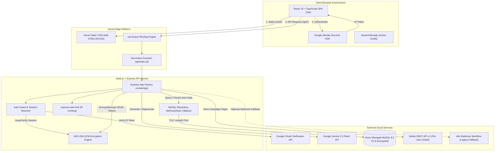

# Brand Voice AI

> **AI-Powered Editorial Studio for Brand Voice Synthesis & 10-Draft Social Campaign Orchestration**

[](https://brand-voice-wizard-34.vercel.app)
[](https://drive.google.com/file/d/1GQ0TQFQSIosNuNOUaJTS3BDnsV16CAgt/view?usp=sharing)
[](https://github.com/surabhi-04/brand-voice-wizard-34)
[](https://react.dev/)
[](https://expressjs.com/)
[](https://aiven.io/mysql)
[](#-testing-and-quality-assurance)

---

## 📌 Quick Links

| Resource | Description | Link |
| :--- | :--- | :--- |
| 🌐 **Live Demo** | Deployed production studio on Vercel | [brand-voice-wizard-34.vercel.app](https://brand-voice-wizard-34.vercel.app) |
| 📺 **Demo Video** | Complete video walkthrough of all workflows | [Watch the Brand Voice AI Demo](https://drive.google.com/file/d/1GQ0TQFQSIosNuNOUaJTS3BDnsV16CAgt/view?usp=sharing) |
| 📦 **Source Code** | GitHub repository, automated test suites, and server code | [github.com/surabhi-04/brand-voice-wizard-34](https://github.com/surabhi-04/brand-voice-wizard-34) |
| 📋 **Product Requirements (PRD)** | Complete 25-section Product Requirements Document | [`docs/PRD.md`](docs/PRD.md) |
| 🛠️ **Tech Stack Specification** | Deep-dive breakdown of all 18 infrastructure layers | [`docs/TECH-STACK.md`](docs/TECH-STACK.md) |
| 🏗️ **System Architecture** | Technical design, security boundaries, and data flows | [`docs/ARCHITECTURE.md`](docs/ARCHITECTURE.md) |
| 🎨 **UI/UX Design Document** | Design system tokens, interaction flows, and 16 screenshots | [`docs/DESIGN-DOCUMENT.md`](docs/DESIGN-DOCUMENT.md) |
| 🔌 **API Service Contracts** | Frontend-to-backend request and response schemas | [`docs/api-contracts.md`](docs/api-contracts.md) |

---

## 📺 Demo Video

A full end-to-end video demonstration showcasing Brand Voice AI in action—from entering a raw brand brief, synthesizing the brand voice profile, generating 10 distinct campaign tweets, performing atomic single-tweet regeneration, signing in with Google, persisting campaign history in MySQL, to saving directly into a connected Notion workspace:

▶️ **[Watch the Brand Voice AI Demo](https://drive.google.com/file/d/1GQ0TQFQSIosNuNOUaJTS3BDnsV16CAgt/view?usp=sharing)**

*(Hosted on Google Drive • Full HD Walkthrough of Studio Features & Notion Integration)*

---

## 📖 Project Overview

### The Problem
Marketing teams, brand strategists, founders, and social media managers spend countless hours translating raw brand briefs into authentic, on-brand social media campaigns. Standard conversational AI tools (like ChatGPT or Claude) create friction: they require repetitive prompt engineering, lack character limit enforcement, fail to provide varied creative angles, and return monolithic text walls that cannot be easily edited, saved, or synced to team workspaces.

### The Solution: Brand Voice AI
**Brand Voice AI** is a purpose-built, single-page editorial studio that automates this workflow with precision:
1. **Brief Ingestion**: Users supply basic brand parameters (brand name, industry, campaign objective, product details, target audience, tone chips, and emoji preferences).
2. **Deterministic AI Extraction**: Powered by **Google Gemini 2.5 Flash**, the engine synthesizes an authentic **Brand Voice Profile** detailing voice summary, audience breakdown, 5 strategic content themes, and 5 core writing style characteristics—with transparent badges indicating inferred traits.
3. **10 Diverse Campaign Tweets**: The system drafts exactly 10 distinct, non-repetitive posts spanning varied angles (`[Promotional]`, `[Conversational]`, `[Educational]`, `[Storytelling]`, `[Community-focused]`, `[Behind-the-scenes]`, `[Customer-spotlight]`, etc.), each strictly compliant with the 280-character limit.
4. **Micro-Editorial Control**: Users can copy individual tweets with 1 click, copy all tweets at once, or trigger **atomic per-tweet regeneration** without losing the other 9 approved drafts.
5. **Persistent Cloud Library & Notion Export**: Users can sign in with Google to store their campaign history in a multi-tenant **MySQL 8.0** cloud database (Aiven) and export structured pages directly to their personal **Notion** workspace via OAuth 2.0.

---

## 🚀 Key Features

### 🎨 Editorial Studio Experience
- **Single-Page Continuous Canvas**: Eliminates multi-step wizard friction by keeping the brief form, brand voice profile, and tweet cards accessible on one scrollable surface.
- **Guest Demo Mode**: Unauthenticated visitors can immediately test the generation engine without an upfront login barrier. Drafts are safely preserved in browser `sessionStorage` during page transitions.
- **Dual-Theme Editorial Aesthetics**: Full theme parity featuring a warm, tactile **Paper Light** theme (`#F7F5EF` / `oklch(0.973 0.009 92)`) and an **Obsidian Dark** theme (`#161715` / `oklch(0.175 0.008 105)`).
- **Responsive Layout**: Fluidly adapts across mobile smartphones (390px), tablets (768px), and high-resolution desktops (1440px+).

### ✍️ AI Voice & Content Synthesis
- **Structured Brand Voice Profile**: Generates voice narrative, target audience, strategic content themes, and writing characteristics with visual badges marking inferred fields.
- **10-Angle Tweet Generation**: Generates 10 creative drafts categorized by distinct marketing angles, tone indicators, and live character counters (`< 280 chars`).
- **Atomic Single-Tweet Regeneration**: Refresh any individual tweet card in ~2.5 seconds without re-generating or discarding the other 9 drafts.
- **Emoji Distribution Engine**: Enforces explicit emoji usage settings (e.g., exact counts such as "4 out of 10 tweets").

### 🔐 Authentication & Multi-Tenant Security
- **Google Sign-In (GIS)**: Client-side Google Identity Services button with server-side ID token verification using `google-auth-library`.
- **JWT Session Management**: 24-hour HMAC-SHA256 user sessions stored securely in `HttpOnly`, `SameSite: Lax`, `Secure` cookies (`bv_session`). Browser `localStorage` is never used for authentication tokens.
- **Guest-to-User Campaign Transfer**: Smoothly migrates drafts generated in Guest Demo Mode into the user's permanent MySQL account upon sign-in.

### 🗄️ Persistence & Third-Party Integrations
- **Cloud MySQL 8.0 on Aiven**: Robust multi-tenant schema (`users`, `campaigns`, `user_notion_connections`) featuring TLS encryption with strict CA verification (`rejectUnauthorized: true`), connection pooling, and automatic migrations.
- **Direct Notion Public OAuth 2.0**: Users connect their private Notion workspaces; tokens are encrypted at rest using **AES-256-GCM** with 256-bit keys and authenticated authentication tags.
- **Notion Page Block Export**: Dispatches campaigns directly into Notion as formatted heading, callout, bullet, and numbered list blocks via the official Notion REST API v1.
- **Backward-Compatible n8n Webhook**: Supports legacy webhook automation (`N8N_NOTION_WEBHOOK_URL`) as an alternative dispatch fallback.

---

## 📸 Application Screenshots

All screenshots below represent the actual live application running in production and verified reference workspace data:

### Desktop Editorial Studio
| Landing Page & Hero Studio (Light Mode) | Obsidian Dark Theme Parity |
| :---: | :---: |
|  |  |
| *Editorial typography hero with "Try Demo" and Google Sign-In* | *Tactile obsidian charcoal theme for comfortable low-light editing* |

### Campaign Creation & Generation
| Campaign Brief Form (WildStone Brief) | Synthesized Brand Voice Profile Card |
| :---: | :---: |
|  |  |
| *Structured inputs with tone selection chips and emoji controls* | *Strategic voice summary, audience, 5 themes, and 5 style attributes* |

### Editorial Controls & Refinement
| Ten Campaign Tweet Drafts Collection | Atomic Single-Tweet Regeneration |
| :---: | :---: |
|  |  |
| *10 diverse drafts with angle badges, tones, and character counters* | *Regenerating Card #2 in isolation without altering other drafts* |

### Authentication & Cloud Persistence
| Guest Demo Mode Intercept (Google Sign-In) | User Campaign Library (`#library`) |
| :---: | :---: |
|  |  |
| *Deferred authentication intercept when saving guest campaigns* | *Historical campaigns stored in MySQL and scoped per authenticated user* |

### Notion Workspace Export
| Save Confirmation & Destination Link | Exported Notion Campaign Page |
| :---: | :---: |
|  |  |
| *Button morphs into live external link: "Saved · View in Notion"* | *Live Notion page with structured bullet blocks and 10 tweet items* |

### Mobile Responsive Interface (390 × 844 px)
| Mobile Navigation & Hero | Mobile Campaign Creation Form | Mobile Tweet Cards Stack |
| :---: | :---: | :---: |
|  |  |  |
| *Fluid header with drawer menu* | *Stacked touch-optimized inputs* | *Full-width mobile reading cards* |

---

## 🛠️ Technology Stack

| Layer | Technology | Purpose | Documentation Link |
| :--- | :--- | :--- | :--- |
| **Frontend Framework** | **React 19.2.0** | Component architecture, hooks, and reactive studio state | [react.dev](https://react.dev/) |
| **Frontend Language** | **TypeScript 5.8.3** | Strict type safety, interface contracts, and schema mapping | [typescriptlang.org](https://www.typescriptlang.org/) |
| **Build & Dev Tool** | **Vite 8.1.5** | High-speed HMR development server and production Rollup bundling | [vitejs.dev](https://vitejs.dev/) |
| **Styling & CSS** | **Tailwind CSS 4.2.1** | Modern utility-first CSS, `@theme` tokens, and OKLCH colors | [tailwindcss.com](https://tailwindcss.com/) |
| **UI Primitives** | **Radix UI** | Accessible headless primitives (Dialog, Tooltip, Dropdown Menu) | [radix-ui.com](https://www.radix-ui.com/) |
| **Icons & Alerts** | **Lucide React + Sonner** | SVG iconography and high-performance toast notifications | [lucide.dev](https://lucide.dev/) |
| **Backend Runtime** | **Node.js (ESM)** | Server-side execution environment (v18.0.0+ / verified v22.18.0) | [nodejs.org](https://nodejs.org/) |
| **Backend Framework** | **Express 4.21.2** | REST API routing, cookie parsing, and rate limiting | [expressjs.com](https://expressjs.com/) |
| **Serverless Adapter** | **Vercel Adapter (`api/index.js`)** | Routes incoming serverless HTTP invocations to Express | [vercel.com](https://vercel.com/) |
| **Schema Validation** | **Zod 3.24.2 / 3.25.76** | Runtime schema coercion and boundary contract validation | [zod.dev](https://zod.dev/) |
| **Generative AI** | **Google Gemini 2.5 Flash** | Brand voice reasoning, 10 tweet generation, and regeneration | [ai.google.dev](https://ai.google.dev/) |
| **Relational Database** | **MySQL 8.0 (Aiven Cloud)** | Multi-tenant storage for users, campaigns, and OAuth tokens | [aiven.io](https://aiven.io/mysql) |
| **Database Driver** | **mysql2 3.24.6** | Prepared statements, connection pooling, and strict TLS CA support | [github.com/sidorares/node-mysql2](https://github.com/sidorares/node-mysql2) |
| **Authentication** | **Google Identity Services + JWT** | GIS Web SDK token verification (`google-auth-library` 11.3) + JWT | [developers.google.com/identity](https://developers.google.com/identity) |
| **Workspace Sync** | **Notion Public OAuth 2.0 & REST** | Per-user workspace authorization and direct block page export | [developers.notion.com](https://developers.notion.com/) |
| **Data Encryption** | **AES-256-GCM (`node:crypto`)** | Authenticated token encryption at rest (`<iv>:<tag>:<ciphertext>`) | [nodejs.org/api/crypto.html](https://nodejs.org/api/crypto.html) |
| **Testing Engines** | **Vitest 4.1 + `node:test`** | 117 automated unit, integration, and security tests | [vitest.dev](https://vitest.dev/) |
| **Production Hosting**| **Vercel Edge Platform** | Static edge CDN distribution and serverless API execution | [vercel.com](https://vercel.com/) |

*For complete dependency manifests, version tables, and architectural rationale, inspect [`docs/TECH-STACK.md`](docs/TECH-STACK.md).*

---

## 🏗️ System Architecture

Brand Voice AI implements a decoupled, security-first cloud architecture:
- Static client assets are served from global edge CDNs via Vercel.
- Private credentials, database passwords, OAuth secrets, and AI API keys are strictly insulated inside the Node.js Express backend.
- Communication between client and backend occurs via JSON REST endpoints over HTTPS using `credentials: "include"` for HttpOnly cookie authentication.



---

## 📁 Project Directory Structure

```text
brand-voice-wizard-34/
├── api/
│   └── index.js                    # Vercel serverless adapter wrapping the Express app
├── docs/
│   ├── design-assets/              # 16 verified application screenshots and reference images
│   ├── ARCHITECTURE.md             # Detailed technical architecture and data flow specs
│   ├── DESIGN-DOCUMENT.md          # Comprehensive UI/UX design and design tokens guide
│   ├── PRD.md                      # Complete 25-section Product Requirements Document
│   ├── PRD-REVIEW-CHECKLIST.md     # Requirements verification and acceptance criteria
│   ├── TECH-STACK.md               # 18-layer technology stack and dependency inventory
│   └── api-contracts.md            # Frontend-backend typed schema contracts
├── public/
│   ├── favicon.ico                 # Studio feather favicon
│   └── placeholder.svg             # Default media placeholder
├── server/
│   ├── src/
│   │   ├── app.js                  # Express app factory (createApp) with all API endpoints
│   │   ├── auth.js                 # Google ID token verification and JWT session engine
│   │   ├── config.js               # Validated server configuration and environment loader
│   │   ├── crypto.js               # AES-256-GCM token encryption & OAuth CSRF state HMAC
│   │   ├── db.js                   # MySQL connection pool, TLS CA config, and migrations
│   │   ├── gemini.js               # Google Gemini 2.5 Flash integration and 5-stage normalizer
│   │   ├── index.js                # Local server entry point (listens on PORT 3001)
│   │   ├── notion.js               # Notion OAuth 2.0 exchange, destinations, and block export
│   │   ├── repository.js           # MySQLRepository and in-memory MemoryRepository fallback
│   │   └── schema.sql              # Database DDL (users, campaigns, user_notion_connections)
│   ├── test/                       # 12 test suites (63 tests) using native node:test runner
│   │   ├── auth.test.js            # Authentication and session security tests
│   │   ├── crypto.test.js          # AES-256-GCM encryption and OAuth state tests
│   │   ├── gemini.test.js          # Gemini prompt and output normalization tests
│   │   ├── mysql.test.js           # MySQL pool, Aiven TLS certificates, and migrations
│   │   ├── notion.test.js          # Notion OAuth, token isolation, and page export tests
│   │   └── ...                     # Repository and route integration test suites
│   ├── .env.example                # Server environment template
│   └── package.json                # Backend dependencies and test scripts
├── src/
│   ├── components/
│   │   ├── auth/                   # GoogleSignInButton, UserMenu, SignInRequiredModal
│   │   ├── studio/                 # BrandVoiceStudio, Notion modals, workspace status
│   │   └── ui/                     # Accessible Radix UI primitives and styled components
│   ├── hooks/
│   │   ├── use-theme.ts            # Light / dark theme management with localStorage sync
│   │   └── use-toast.ts            # Toast notification hooks
│   ├── lib/
│   │   ├── api.ts                  # Fetch client wrapper with credentials: "include"
│   │   ├── auth.ts                 # Google authentication state context and provider
│   │   ├── campaign-service.ts     # Client campaign generation, regeneration, and saving
│   │   ├── notion-service.ts       # Client Notion status, destinations, and OAuth helpers
│   │   ├── types.ts                # Core TypeScript interfaces and shared Zod schemas
│   │   └── utils.ts                # Classname utilities (cn)
│   ├── test/                       # 5 test suites (54 tests) using Vitest
│   │   ├── auth-flow.test.tsx      # Google sign-in and guest demo mode tests
│   │   ├── brand-voice-studio.test.tsx # Studio form, generation, and regeneration tests
│   │   ├── campaign-service.test.ts # Client API service contract tests
│   │   ├── notion-integration.test.tsx # Notion modal and destination selection tests
│   │   └── theme.test.tsx          # Theme switching and DOM class toggle tests
│   ├── App.tsx                     # Main application view container
│   ├── main.tsx                    # Vite entry point and DOM root mounter
│   └── styles.css                  # Tailwind CSS v4 design tokens and custom styles
├── .env.example                    # Frontend environment template
├── package.json                    # Frontend dependencies, npm workspaces, and scripts
├── vercel.json                     # Vercel deployment routing and function duration settings
└── vite.config.ts                  # Vite build configuration, path aliases, and dev proxy
```

---

## 💻 Local Installation and Setup

### Prerequisites
- **Node.js**: `v18.0.0` or higher (verified working on `v22.18.0`)
- **npm**: `v9.0.0` or higher
- **MySQL Database**: Local MySQL 8.0+ instance OR a cloud MySQL service (e.g., Aiven). *Note: If MySQL is not configured, the backend automatically uses an in-memory repository for local development and testing.*

---

### Step 1: Clone the Repository
```bash
git clone https://github.com/surabhi-04/brand-voice-wizard-34.git
cd brand-voice-wizard-34
```

---

### Step 2: Install Dependencies
The repository is configured with npm workspaces. Install all root and server dependencies with:
```bash
npm install
npm install --prefix server
```

---

### Step 3: Configure Environment Variables

1. **Frontend Configuration**:
   ```bash
   cp .env.example .env
   ```
   *(For local development, the default settings in `.env.example` point to the Vite proxy `/api` automatically).*

2. **Backend Configuration**:
   ```bash
   cp server/.env.example server/.env
   ```
   Edit `server/.env` and supply your API keys and credentials:
   - `GEMINI_API_KEY`: API key from [Google AI Studio](https://aistudio.google.com/).
   - `GOOGLE_CLIENT_ID`: OAuth Web Client ID from [Google Cloud Console](https://console.cloud.google.com/).
   - `JWT_SECRET`: A secure 64-character hex string (generate via: `node -e "console.log(require('crypto').randomBytes(32).toString('hex'))"`).
   - `NOTION_TOKEN_ENCRYPTION_KEY`: A dedicated 64-character hex key for AES-256-GCM token encryption.
   - `MYSQL_USER` and `MYSQL_PASSWORD`: Your MySQL credentials (leave blank to use the in-memory fallback).

---

### Step 4: Run the Application

Open two terminal windows:

#### Terminal 1: Start the Backend Service
```bash
npm run dev --prefix server
```
*The Express API will initialize on `http://localhost:3001` and run database migrations automatically.*

#### Terminal 2: Start the Frontend Studio
```bash
npm run dev
```
*The Vite development server will start on `http://localhost:8080` with an active proxy forwarding `/api/*` to port 3001.*

Open **`http://localhost:8080`** in your browser to start using Brand Voice AI.

---

## 🔐 Environment Variables Reference

| Variable Name | Description | Required | Scope | Example / Default |
| :--- | :--- | :---: | :---: | :--- |
| **Frontend Variables (`.env`)** | | | | |
| `VITE_API_BASE_URL` | Public origin of the deployed backend API (blank when using local Vite proxy) | Optional | Frontend-Safe | `http://localhost:3001` |
| `VITE_GOOGLE_CLIENT_ID` | Google OAuth Client ID fallback (also fetched dynamically via `/api/auth/config`) | Optional | Frontend-Safe | `123456...apps.googleusercontent.com` |
| **Backend Variables (`server/.env`)** | | | | |
| `PORT` | Local HTTP port for Express server | Optional | Server-Only | `3001` |
| `FRONTEND_ORIGIN` | Allowed CORS origin for credentials-included requests | Optional | Server-Only | `http://localhost:8080` |
| `GEMINI_API_KEY` | Google AI Studio API key for Gemini 2.5 Flash | **Yes** | Server-Only | `AIzaSy...` (Private) |
| `GEMINI_MODEL` | Google Gemini model identifier | Optional | Server-Only | `gemini-2.5-flash` |
| `GOOGLE_CLIENT_ID` | Google OAuth Web Client ID for server token verification | **Yes** | Server-Only | `123456...apps.googleusercontent.com` |
| `JWT_SECRET` | 256-bit random string for signing user session cookies | **Yes** | Server-Only | `openssl rand -hex 32` (Private) |
| `MYSQL_HOST` | MySQL database host address | Optional | Server-Only | `localhost` or cloud hostname |
| `MYSQL_PORT` | MySQL database custom port | Optional | Server-Only | `3306` or cloud port |
| `MYSQL_DATABASE` | MySQL database schema name | Optional | Server-Only | `brand_voice_ai` or `defaultdb` |
| `MYSQL_USER` | MySQL database username | Optional | Server-Only | `root` or cloud user |
| `MYSQL_PASSWORD` | MySQL database user password | Optional | Server-Only | `********` (Private) |
| `MYSQL_SSL` | Enable TLS encryption for database connections | Optional | Server-Only | `true` |
| `MYSQL_CA_CERT` | PEM certificate text for cloud database CA authority (Aiven) | Optional | Server-Only | `-----BEGIN CERTIFICATE-----...` |
| `MYSQL_SKIP_CREATE_DB` | Set to `true` when connecting to pre-provisioned cloud databases | Optional | Server-Only | `true` |
| `NOTION_OAUTH_CLIENT_ID` | Notion Public Integration Client ID | Optional | Server-Only | `oauth_client_id_here` |
| `NOTION_OAUTH_CLIENT_SECRET`| Notion Public Integration Client Secret | Optional | Server-Only | `oauth_client_secret_here` (Private) |
| `NOTION_OAUTH_REDIRECT_URI` | Authorized Notion OAuth callback URL | Optional | Server-Only | `https://<domain>/api/notion/oauth/callback` |
| `NOTION_TOKEN_ENCRYPTION_KEY`| 64-char hex key for AES-256-GCM token encryption at rest | Optional | Server-Only | `openssl rand -hex 32` (Private) |
| `N8N_NOTION_WEBHOOK_URL` | Legacy n8n webhook URL for Notion export fallback | Optional | Server-Only | `https://n8n.../webhook/...` |

> [!CAUTION]
> **Zero Secret Leakage Guarantee**: Never commit `.env` or `server/.env` files to source control. Never prefix sensitive server credentials (database passwords, API keys, JWT secrets) with `VITE_`, which would expose them to client browser bundles.

---

## 🧪 Testing and Quality Assurance

The codebase features a dual-layer testing architecture with **117 automated tests verified passing**:

```text
================================================================================
Test Suite Summary: 117 Passed, 0 Failed, 100% Passing
================================================================================
- Frontend (Vitest 4.1):  54 Tests across 5 Test Files (100% Pass)
- Backend (node:test):    63 Tests across 12 Test Suites (100% Pass)
================================================================================
```

### 1. Run Frontend Tests (Vitest)
Executes component integration, user interaction, theme toggling, and service contract tests:
```bash
npm test
```
*Verified output: `5 passed (5) | 54 passed (54)` in `~29s`.*

### 2. Run Backend Tests (Node Native Runner)
Executes token verification, session guards, AES-256-GCM encryption, MySQL TLS configuration, Gemini normalizer, and Notion OAuth tests:
```bash
npm test --prefix server
```
*Verified output: `12 suites passed | 63 tests passed | 0 fail` in `~10s`.*

### 3. Run Production Build Validation
Validates TypeScript compilation and builds the Rollup static production bundle:
```bash
npm run build
```
*Verified output: Clean bundle in `dist/` with zero TypeScript or bundling errors.*

---

## 🔌 API Route Catalog

All backend endpoints are prefixed with `/api` and strictly validate input payloads via Zod:

| Method | Endpoint | Description | Auth Required |
| :--- | :--- | :--- | :---: |
| `GET` | `/api/health` | Service health probe, database status, and configuration check | Public |
| `GET` | `/api/auth/config` | Returns public Google Client ID for client GIS button initialization | Public |
| `POST`| `/api/auth/google` | Verifies Google ID token, upserts user in MySQL, and sets session cookie | Public |
| `GET` | `/api/auth/me` | Validates session cookie and returns active authenticated user profile | **User** |
| `POST`| `/api/auth/logout` | Clears `bv_session` HttpOnly cookie and terminates session | Public |
| `POST`| `/api/campaigns/generate` | Generates brand voice profile and 10 tweets (Rate limited) | Guest / User |
| `POST`| `/api/campaigns/:id/tweets/:num/regenerate` | Regenerates a single tweet card in isolation | Guest / User |
| `POST`| `/api/campaigns/:id/regenerate` | Regenerates all 10 tweet cards in a batch | Guest / User |
| `GET` | `/api/campaigns/history` | Retrieves all saved campaigns belonging to the authenticated user | **User** |
| `POST`| `/api/campaigns/transfer-guest` | Migrates guest draft campaign to newly logged-in user account | **User** |
| `GET` | `/api/notion/status` | Returns Notion connection state, workspace name, and destination | **User** |
| `GET` | `/api/notion/oauth/authorize` | Generates CSRF-protected Notion OAuth authorization URL | **User** |
| `GET` | `/api/notion/oauth/callback` | Exchanges code for Notion token, encrypts with AES-256-GCM | Public |
| `GET` | `/api/notion/destinations` | Lists accessible workspace pages and databases for campaign saving | **User** |
| `POST`| `/api/notion/destination` | Updates user's default Notion parent page save destination | **User** |
| `POST`| `/api/campaigns/:id/notion-save` | Formats campaign and creates page blocks in Notion workspace | **User** |
| `POST`| `/api/notion/disconnect` | Revokes Notion connection and removes stored encrypted token | **User** |

---

## 🔒 Data Security & Privacy Architecture

- **Zero Client Credential Exposure**: Third-party credentials (Gemini API keys, Google Client Secrets, Notion OAuth secrets, database passwords) are never bundled into client JavaScript.
- **Cryptographic Encryption at Rest**: Per-user Notion OAuth access tokens are encrypted in MySQL using **AES-256-GCM** with unique 96-bit initialization vectors (`iv`) and 128-bit authentication tags (`tag`).
- **CSRF-Protected OAuth States**: Notion authorization requests include a signed HMAC-SHA256 state parameter bound to the user's ID, preventing authorization injection and CSRF attacks.
- **Strict Database TLS Verification**: Aiven MySQL connections enforce TLS with certificate authority validation (`rejectUnauthorized: true`), neutralizing man-in-the-middle risks.
- **Multi-Tenant User Isolation**: Database queries enforce `WHERE user_id = ?` scoping on all campaign and Notion connection records. Unauthorized cross-user access attempts return `403 Forbidden`.
- **Intelligent Rate Limiting**: The backend employs `express-rate-limit` to protect public AI generation endpoints against denial-of-wallet and quota exhaustion (10 requests / 15 min for guests; 50 requests / 15 min for authenticated users).

---

## 📚 Project Documentation

Comprehensive architectural and engineering specifications are maintained under `docs/`:

- 📋 [**Product Requirements Document (PRD)**](docs/PRD.md): Complete product vision, user personas, functional requirements, and milestone roadmap.
- 🛠️ [**Technology Stack Specification**](docs/TECH-STACK.md): Full 18-layer technical breakdown with verified package manifests and infrastructure trade-offs.
- 🏗️ [**System Architecture Specification**](docs/ARCHITECTURE.md): Technical diagrams, data flow lifecycles, and security boundary documentation.
- 🎨 [**UI/UX Design Document**](docs/DESIGN-DOCUMENT.md): Visual design language, design tokens, responsive breakpoints, accessibility audit, and screen analysis.
- 🔍 [**PRD Verification & Review Checklist**](docs/PRD-REVIEW-CHECKLIST.md): Quality checklist confirming implementation alignment.
- 🔌 [**API Service Contracts**](docs/api-contracts.md): Typed Zod schemas and integration contracts.

---

## ⚠️ Known Technical Constraints & Planned Roadmap

### Current Constraints
1. **Serverless Ephemeral Sockets**: Under high traffic spikes, serverless environments can exhaust database connection pools. Handled by capping the pool at 3 connections on Vercel and memoizing instances.
2. **Batch AI Generation Latency**: Generating a complete brand voice profile and 10 tailored tweets takes 3–5 seconds of Gemini reasoning time. Handled by cycling status animations to maintain user engagement.
3. **Notion API Rate Limits**: The Notion REST API enforces an average limit of 3 requests per second per integration token. Handled by caching save results to prevent duplicate dispatches.

### Planned Roadmap
- [ ] **Streaming Output Delivery (SSE)**: Stream individual tweet cards onto the canvas progressively as Gemini generates them.
- [ ] **Distributed Redis Cache (Upstash)**: Edge caching for generated brand voice profiles and global rate limit tracking.
- [ ] **Direct X/Twitter API v2 Publishing**: 1-click publishing directly to X accounts from the studio canvas.
- [ ] **Vector Memory (pgvector)**: Long-term brand voice memory to fine-tune future campaigns based on past high-performing tweets.

---

## 👤 Author & Project Context

- **Author / Repository Owner**: [Surabhi](https://github.com/surabhi-04)
- **GitHub Repository**: [surabhi-04/brand-voice-wizard-34](https://github.com/surabhi-04/brand-voice-wizard-34)
- **Live Production Studio**: [brand-voice-wizard-34.vercel.app](https://brand-voice-wizard-34.vercel.app)

*Brand Voice AI was engineered as a production-grade full-stack showcase demonstrating modern React 19 architecture, secure serverless Node.js design, Google Generative AI integration, cloud relational persistence, and third-party OAuth workspace synchronization.*
