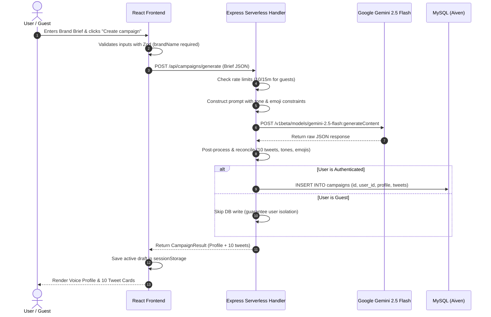
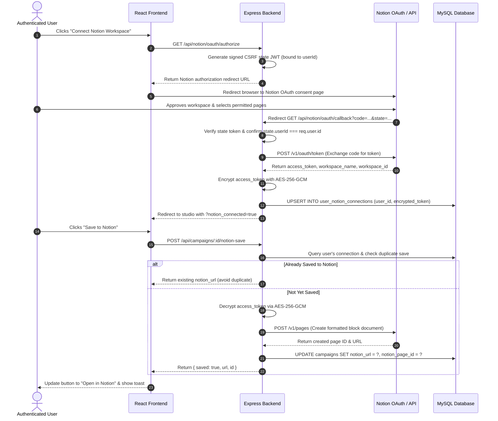

# Brand Voice AI — System Architecture & Technical Design

This document details the software architecture, data flows, security boundaries, and infrastructure integration models for the **Brand Voice AI** full-stack studio.

---

## 1. High-Level Architecture Diagram

```mermaid
flowchart TD
    subgraph Client["Client Browser Environment"]
        SPA["React 19 + TypeScript SPA (Vite)"]
        GIS["Google Identity Services SDK"]
        Storage["SessionStorage (Active Drafts)"]
    end

    subgraph Edge["Vercel Edge Platform"]
        CDN["Vercel Static CDN (dist/ HTML/JS/CSS)"]
        Rewrites["vercel.json Routing Engine"]
        Serverless["api/index.js (Serverless Handler)"]
    end

    subgraph AppServer["Express Application Microservice"]
        Express["Express App Instance (createApp)"]
        CORS["CORS & Cookie Parser Middleware"]
        RateLimit["Rate Limiting (50/15m auth, 10/15m guest)"]
        AuthModule["Google ID Token Verifier & JWT Signer"]
        CryptoModule["AES-256-GCM Token Encryption"]
        GeminiOrchestrator["Gemini 2.5 Flash Prompt Orchestrator"]
        NotionClient["Notion OAuth & REST Block Generator"]
        DBRepo["MySQL Repository / Connection Pool"]
    end

    subgraph DataCloud["External Providers & Cloud Infrastructure"]
        GoogleOAuth["Google Cloud OAuth 2.0 Endpoint"]
        GeminiREST["Google Gemini REST API (v1beta)"]
        NotionREST["Notion API v1 (Pages & Search)"]
        AivenMySQL[("Aiven Managed MySQL 8.0 (TLS Encrypted)")]
    end

    %% Client Interactions
    SPA -->|1. Static Assets| CDN
    SPA -->|2. /api/* Requests| Rewrites
    Rewrites -->|3. Forward to Adapter| Serverless
    Serverless -->|4. Execute Request| Express

    %% Authentication Flow
    GIS -->|Deliver ID Token Credential| SPA
    SPA -->|POST /api/auth/google| Express
    Express --> AuthModule
    AuthModule -->|Verify Token Audience| GoogleOAuth
    AuthModule -->|Set HttpOnly Cookie| SPA

    %% AI Campaign Generation Flow
    SPA -->|POST /api/campaigns/generate| Express
    Express --> GeminiOrchestrator
    GeminiOrchestrator -->|HTTPS POST (30s Timeout)| GeminiREST
    GeminiOrchestrator -->|Reconcile Tones & Emojis| Express

    %% Notion OAuth & Persistence
    SPA -->|GET /api/notion/oauth/authorize| Express
    Express -->|Sign CSRF State JWT| CryptoModule
    SPA -->|Redirect via Notion OAuth| NotionREST
    NotionREST -->|Redirect Callback with Code| Express
    Express -->|Exchange Code for Token| NotionREST
    Express -->|AES-256-GCM Encrypt Token| CryptoModule
    Express -->|Store Connection Data| DBRepo

    %% Direct Notion Export
    SPA -->|POST /api/campaigns/:id/notion-save| Express
    Express -->|Decrypt Token| CryptoModule
    Express -->|Create Formatted Blocks| NotionClient
    NotionClient -->|POST /v1/pages| NotionREST

    %% Database Connection
    DBRepo -->|Pool TLS Connection (Port 3306)| AivenMySQL
```

---

## 2. Layer-by-Layer Architectural Responsibilities

### 2.1 Presentation Layer (`src/`)
- **Technology**: React 19, TypeScript, Tailwind CSS, Lucide React, Sonner.
- **Role**:
  - Manages reactive studio state (campaign inputs, active drafts, brand voice profiles, generated tweet cards).
  - Handles client-side character counting (<280 chars) and tone adherence indicators.
  - Controls modal dialog states for authentication requirements, Notion connection, and destination page selection.
  - Persists active guest drafts in browser `sessionStorage` (`brand_voice_active_campaign`) to survive OAuth redirect transitions.
  - Delivers seamless light/dark mode theming via `useTheme` hook with `localStorage` persistence.

### 2.2 Edge & Routing Layer (`vercel.json` & `api/index.js`)
- **Technology**: Vercel Static CDN, Serverless Function Runtime (Node.js 20+ ESM).
- **Role**:
  - Serves static assets (`dist/assets/*`, `index.html`) from edge CDN caches with optimal caching headers.
  - Intercepts all requests matching `/api/(.*)` and forwards them to the serverless function adapter in [`api/index.js`](file:///C:/Users/surab/brand-voice-wizard-34/api/index.js).
  - Catches all non-API paths (`/(.*)`) and rewrites them to `/index.html` to support client-side SPA routing.
  - Enforces a 60-second execution maximum (`maxDuration: 60`) for complex generative AI workflows.
  - Implements warm-instance connection memoization (`appInstance` and `initPromise`) to reuse database pools across invocations.

### 2.3 Application & Security Layer (`server/src/app.js`, `auth.js`, `crypto.js`)
- **Technology**: Express 4.21, `google-auth-library`, `jsonwebtoken`, `crypto` (native Node).
- **Role**:
  - Serves as the security gatekeeper: parses incoming JSON bodies (1MB limit) and HttpOnly session cookies.
  - Protects auth and generation routes with `express-rate-limit` to prevent brute-force attacks and quota exhaustion.
  - Validates Google ID tokens against `GOOGLE_CLIENT_ID` using Google's public keys.
  - Issues 24-hour application session JWTs delivered in `HttpOnly`, `SameSite: Lax`, `Secure` (production) cookies.
  - Generates tamper-proof, 15-minute expiration OAuth state tokens bound to the user's ID for CSRF protection.
  - Encrypts and decrypts external Notion access tokens at rest using **AES-256-GCM** with a dedicated 256-bit key.

### 2.4 Generative Reasoning Layer (`server/src/gemini.js`)
- **Technology**: Google Gemini 2.5 Flash, Native Fetch API, AbortController.
- **Role**:
  - Constructs structured prompt payloads combining the user's brief, tone constraints, and emoji instructions.
  - Queries Google Gemini with `responseMimeType: "application/json"` and temperature `0.7`.
  - Enforces a strict 30-second execution abort timeout.
  - Applies a post-processing algorithm to validate exactly 10 tweets, enforce tone adherence, prevent angle-tone label collisions, and reconcile emoji counts.

### 2.5 Persistence Layer (`server/src/db.js`, `server/src/schema.sql`)
- **Technology**: MySQL 8.0 (Aiven Cloud), `mysql2/promise`.
- **Role**:
  - Manages connection pooling with capped connection limits for serverless instances (`connectionLimit: 3`).
  - Auto-executes idempotent migrations (`CREATE TABLE IF NOT EXISTS`) for `users`, `campaigns`, and `user_notion_connections`.
  - Enforces foreign key cascading constraints and indexed lookups (`google_id`, `email`, `user_id`).
  - Supports strict TLS certificate verification (`rejectUnauthorized: true`) with injectable `MYSQL_CA_CERT` PEM data.
  - Provides a complete `MemoryRepository` fallback for local development or testing environments when MySQL is not provisioned.

---

## 3. Detailed Data Flows

### 3.1 AI Campaign Generation Flow



---

### 3.2 Notion OAuth Connection & Campaign Save Flow



---

## 4. Multi-Tenant Data Isolation Matrix

| Layer | Isolation Mechanism | Verification Evidence |
| :--- | :--- | :--- |
| **Authentication** | Google `sub` ID mapped to internal UUID `usr_*` in `users` table. | `server/test/auth.test.js` |
| **Session State** | Cryptographically signed JWT session cookie (`bv_session`) verified on every request. | `server/test/auth.test.js` |
| **Campaign Storage** | All campaign queries filter strictly by `WHERE user_id = req.user.id`. | `server/test/multi-user-isolation.test.js` |
| **Notion Credentials** | 1-to-1 foreign key relation `user_id UNIQUE` in `user_notion_connections`. | `server/test/multi-user-isolation.test.js` |
| **Token Decryption** | Tokens are decrypted exclusively inside memory for the duration of the export request. | `server/test/notion.test.js` |
| **Guest Demarcation** | Unauthenticated generations are never written to MySQL; isolated in client `sessionStorage`. | `server/test/multi-user-isolation.test.js` |
