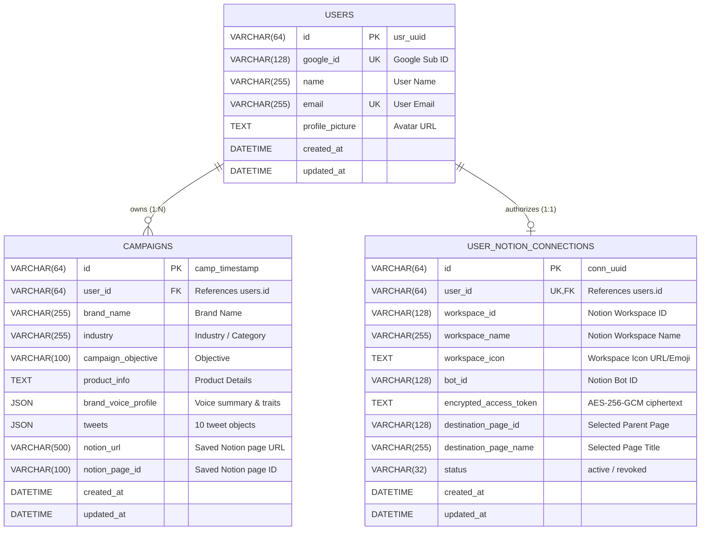

# Product Requirements Document (PRD)
## Brand Voice AI — Editorial Brand Studio & Social Campaign Orchestrator

---

## 1. Document Control

| Attribute | Details |
| :--- | :--- |
| **Product Name** | Brand Voice AI |
| **Document Title** | Product Requirements Document (PRD) — Production Full-Stack Specification |
| **Document Version** | `1.0.0` |
| **Creation Date** | October 19, 2026 |
| **Last Updated** | October 19, 2026 |
| **Document Status** | Approved for Evaluation, Implementation Audit, and Portfolio Review |
| **Author / Role** | Senior Product Manager, Technical Writer & Solutions Architect |
| **Repository Path** | `C:\Users\surab\brand-voice-wizard-34` |
| **Connected Remote** | `https://github.com/surabhi-04/brand-voice-wizard-34.git` (`main` branch) |
| **Intended Audience** | Technical hiring managers, engineering evaluators, product stakeholders, security auditors, and system architects |

### Scope and Assumptions
- **Scope**: This PRD covers the existing implementation of Brand Voice AI as verified directly from repository source code, automated test suites (117 passing tests), database migrations, and runtime deployment configuration on Vercel and Aiven MySQL.
- **Assumptions**:
  1. The application operates as a decoupled single-page application (React 19 + Vite) with an Express microservice backend executing on Vercel Serverless Functions (`api/index.js`).
  2. The Google Gemini 2.5 Flash model serves as the primary generative AI reasoning engine.
  3. External user authentication relies on Google Identity Services (GIS), with per-user persistent authorization to external Notion workspaces handled via official Notion Public OAuth 2.0.
  4. Video asset audit note: A recursive scan for multimedia files (`*.mp4`, `*.webm`, `*.mov`, `*.mkv`) was executed in the workspace root; no demo video file was found in local storage. All UX flows documented herein are derived from executable React component trees, interactive modal behaviors, and comprehensive Vitest/Node test suites.

---

## 2. Executive Summary

**Brand Voice AI** is an intelligent editorial studio and social campaign orchestrator that bridges the gap between raw marketing briefs and cohesive, publication-ready social media content. Marketing teams, agency copywriters, and small-business founders frequently struggle with two persistent bottlenecks: maintaining a distinct, unswerving brand voice across social channels, and overcoming the tedious manual friction of translating campaign goals into diverse, formatted post variations.

Brand Voice AI resolves this by:
1. **Synthesizing Brand Personality**: Ingesting unstructured campaign inputs (brand name, industry, primary objective, product offerings, target audience, and style instructions) and extracting a formal **Brand Voice Profile** containing voice summaries, content pillars, audience definitions, and stylistic characteristics.
2. **Generating Balanced 10-Post Batches**: Leveraging Google Gemini 2.5 Flash to generate exactly 10 distinct, campaign-ready social posts (tweets) with strictly controlled content angles ("Storytelling", "Educational", "Promotional", "Community-focused", etc.), character counts (<280 chars), and fine-grained emoji distribution rules.
3. **Ensuring Strict Tone Compliance**: Guaranteeing that every post adheres strictly to user-selected tones (e.g., Friendly, Bold, Witty) without the generative model hallucinating unselected tones.
4. **Providing Zero-Friction Demo Execution with Enterprise Data Isolation**: Offering an instant unauthenticated Guest Demo Mode for immediate evaluation, while providing Google Sign-In, 24-hour HttpOnly JWT session management, per-user AES-256-GCM encrypted Notion OAuth 2.0 synchronization, and strict multi-tenant row-level data isolation in MySQL.

The intended business and technical outcome is a production-grade, audited full-stack application that demonstrates modern engineering rigor, resilient error boundaries, comprehensive test coverage (117 automated tests), and absolute secret protection.

---

## 3. Product Overview

### 3.1 Product Purpose
Brand Voice AI serves as an editorial copilot for brand storytelling on X (formerly Twitter). It does not merely generate text; it acts as an analytical strategist that explicitly identifies the tone, cadence, and communicative angle before outputting copy. It eliminates blank-page paralysis and provides teams with a reusable repository of brand assets.

### 3.2 Core Capabilities
- **Brief Intake & Validation**: Real-time validated input studio accepting brand parameters, objectives, audience specifics, tone selections, and dual-layer emoji parameters.
- **AI Voice Extraction**: Automatic extraction and synthesis of brand voice profiles, highlighting inferred characteristics versus explicit facts.
- **10-Tweet Generation Engine**: Deterministic generation of 10 structured tweet drafts featuring individual content angles, tone labels, character length counters, and one-click clipboard copying.
- **Granular Regeneration**: In-place regeneration of individual tweets or complete 10-tweet batches without discarding previously approved draft items.
- **Dual-Layer Emoji Distribution Engine**: Algorithmic post-processing that accurately enforces precise user emoji distribution targets (from 0/10 to 10/10) with automatic emoji stripping or tasteful addition.
- **Guest Demo Mode**: Unauthenticated exploration with a 10-generation/15-minute rate limit, client-side draft preservation in `sessionStorage`, and seamless post-login draft adoption via `POST /api/campaigns/transfer-guest`.
- **Google OAuth 2.0 Authentication**: Server-verified Google Identity Services (GIS) integration issuing signed JWTs in `HttpOnly`, `SameSite: Lax` cookies.
- **Per-User Notion OAuth 2.0 Sync**: Public OAuth flow enabling each authenticated user to securely connect their own private Notion workspace, select destination parent pages, and export formatted campaign briefs and tweets into Notion blocks.
- **Cryptographic Token Protection**: AES-256-GCM encryption at rest for external OAuth access tokens, coupled with cryptographically signed, timestamped CSRF state tokens.
- **Cloud-Native Architecture**: Static Vite SPA on Vercel Edge CDN, Serverless Function API routing with memoized connection pools, and managed MySQL 8.0 on Aiven with end-to-end TLS encryption.

### 3.3 Overall User Experience
The user interface is designed around an editorial workspace aesthetic featuring a warm parchment/ink color palette, crisp typography, fluid dark/light mode switching, collapsible help disclosures, and instant visual feedback (spinners, badge tags, Sonner toast notifications, character counters, and confirmation dialogs).

---

## 4. Problem Statement

### 4.1 The Problem
Creating social media campaigns manually presents four critical challenges:
1. **Brand Voice Drift**: When multiple team members or outsourced freelancers write social posts, tone and vocabulary quickly deviate from the core brand guidelines.
2. **Angle Monotony**: Human writers and generic AI prompts tend to default to repetitive promotional slogans rather than exploring diverse communicative angles (e.g., educational breakdowns, behind-the-scenes insights, customer spotlights, and storytelling hooks).
3. **Prompt Engineering Fatigue**: Small-business owners lack the time and technical expertise to construct complex multi-shot prompts that enforce tweet character limits (<280 characters), strict tone compliance, and exact emoji distributions.
4. **Publishing Silos & Tool Fragmentation**: Generated content generated in standalone AI chat tools often gets trapped in ephemeral chat windows, requiring tedious copy-pasting into organizational wikis or project databases like Notion.

### 4.2 The Solution
Brand Voice AI solves these challenges through a unified editorial workflow:
- It structures the input into structured, validated parameters.
- It enforces strict architectural separation between prompt instructions, content angles, and selected tones.
- It normalizes and reconciles AI outputs through a deterministic post-processing pipeline.
- It connects directly to the user's primary project knowledge base (Notion) using secure OAuth 2.0.

### 4.3 Product Boundaries & Non-Goals
- **Non-Goal: Direct Social Publishing**: The system does not directly publish or schedule tweets to the X/Twitter API. Its scope is draft generation, curation, refinement, and knowledge-base persistence.
- **Non-Goal: Graphic/Media Asset Generation**: The application does not generate banner images, video clips, or audio.
- **Non-Goal: Multi-Platform Adaptation**: The generation engine is specialized for short-form social posts (tweets under 280 characters) and does not format for long-form LinkedIn articles or Instagram carousels in this release.

---

## 5. Product Vision and Objectives

### 5.1 Product Vision
To establish Brand Voice AI as the gold-standard editorial brand studio for social content orchestration—combining the intuitive creativity of a human strategist with the precision and speed of modern generative foundation models.

### 5.2 Key Engineering & User Objectives
1. **Quality & Structural Determinism**: Every generation must yield exactly 10 tweets with valid content angles, strict tone adherence, and verified character limits (<280 characters).
2. **Zero-Friction Discovery**: Prospective users and technical evaluators must be able to test the full generation, regeneration, and copy pipeline immediately without logging in.
3. **Absolute Multi-Tenant Security**: Zero cross-user data leakage. A user must never be able to access, modify, or view campaigns or Notion workspaces belonging to another user.
4. **Resilient Production Uptime**: Complete fault-tolerant fallback architecture: if MySQL is unreachable, the system gracefully falls back to an in-memory repository without crashing; if Notion credentials expire, clear re-authorization prompts are surfaced.
5. **Sub-Second Frontend Interactions**: Frontend rendering and UI updates occur instantaneously, with AI generation tasks offloaded and monitored through clear progressive loading indicators.

---

## 6. Target Users and Personas

| Persona | Role & Context | Primary Goals | Key Pain Points | Typical Usage in Brand Voice AI |
| :--- | :--- | :--- | :--- | :--- |
| **Persona 1: Founder Sarah** | Solo Founder / Small Business Owner | Quickly generate launch campaigns without hiring an agency. | Lacks copywriting background; struggles to sound consistent across announcements. | Uses Guest Demo Mode to draft product launch copy, signs in with Google to save to personal Notion workspace. |
| **Persona 2: Strategist Marcus** | Social Media Agency Manager | Maintain distinct brand guidelines for 5+ client accounts simultaneously. | Managing distinct tones across accounts; copying drafts into messy spreadsheets. | Inputs client briefs, selects specific tones (Bold, Witty), reviews 10 angles, syncs directly to client Notion pages. |
| **Persona 3: Content Lead Elena** | In-House Growth Marketer | Create varied weekly social content calendars adhering to strict brand pillars. | Content feels repetitive; emoji usage is inconsistent; posts exceed tweet length limits. | Configures exact emoji distributions ("4 out of 10"), regenerates weaker angles, exports structured markdown documents to company wiki. |
| **Persona 4: Technical Evaluator** | Hiring Manager / Code Reviewer | Assess software architecture, security, test coverage, and documentation rigor. | Black-box projects with missing tests, hardcoded secrets, or unverified claims. | Reviews test suites (117 tests), inspects AES-256-GCM token encryption, verifies MySQL migrations and Vercel routing. |

---

## 7. Scope Definition

### 7.1 Implemented Functionality (Verified in Code & Tests)
- **Brief Input Form**: Brand name, industry, objective (6 standard options), details/product offering, audience, tone multi-selection (7 options), additional instructions, and dual-layer emoji controls.
- **AI Synthesis Pipeline**: Google Gemini 2.5 Flash integration with JSON mode (`application/json`), 30-second timeout handling, and deterministic fallback data.
- **10-Tweet Output Studio**: Structured presentation with character counter, angle tag, tone tag, individual copy button, and individual regeneration trigger.
- **Emoji Control Engine**: Strict zero-emoji enforcement and best-effort distribution matching across 10 tweets.
- **Tone Compliance Engine**: Post-processing logic ensuring no tweet is tagged with an unselected tone.
- **Guest Demo Mode**: Unauthenticated generation and tweet regeneration with 10 req/15 min IP rate limiting and `sessionStorage` draft persistence.
- **Guest-to-User Transfer**: Banner notification and `POST /api/campaigns/transfer-guest` endpoint to transfer guest drafts into MySQL upon Google Sign-In.
- **Google Sign-In**: Official GIS client button, server token verification via `google-auth-library`, user upsert, and 24-hour HttpOnly session cookie issuance.
- **Per-User Notion OAuth 2.0**: Public OAuth handshake, CSRF state signing, AES-256-GCM token encryption at rest, destination page search, and direct Notion REST block creation.
- **Campaign Persistence & Library**: MySQL 8.0 storage with foreign key constraints, user scoping, duplicate save prevention, and campaign history view.
- **Aiven Cloud Compatibility**: Custom port support, SSL/TLS enforcement, and `MYSQL_CA_CERT` PEM certificate injection with strict verification (`rejectUnauthorized: true`).
- **Theme Support**: Seamless Light/Dark mode switching with system preference detection and localStorage persistence.
- **Comprehensive Testing**: 63 backend native tests + 54 frontend Vitest tests (117 total passing tests).

### 7.2 Partially Implemented / Fallback Functionality
- **n8n Webhook Persistence**: Retained strictly as an optional backward-compatibility fallback for unauthenticated test mock environments when Notion OAuth is not configured.
- **In-Memory Repository Fallback**: Automatically activates when MySQL credentials are not supplied, allowing tests and local mock development to run identically without an active database daemon.

### 7.3 Explicitly Out of Scope
- Direct scheduling or publishing to Twitter/X API.
- Multi-image or video generation.
- LinkedIn, Facebook, or Instagram caption reformatting.
- Team collaboration / multi-seat workspace billing.

### 7.4 Potential Future Enhancements
- Multi-platform formatting (LinkedIn, Threads, Bluesky).
- Custom tone creation and persistent brand voice memory across campaigns.
- Direct analytics integration tracking tweet engagement.
- Scheduled publishing via social platform webhooks.

---

## 8. Functional Requirements

| ID | Feature | Requirement Description | Priority | Acceptance Criteria | Implementation Status | Evidence / File Reference |
| :--- | :--- | :--- | :---: | :--- | :---: | :--- |
| **FR-001** | Brief Input | The system shall provide a form capturing brand name, industry, objective, product details, target audience, preferred tones, additional context, and emoji preferences. | P0 | Form validates brand name (required, max 100 chars); objective must be one of 6 preset options; tones must be subset of 7 presets. | **Implemented** | [BrandVoiceStudio.tsx](file:///C:/Users/surab/brand-voice-wizard-34/src/components/studio/BrandVoiceStudio.tsx#L72-L83), [schemas.js](file:///C:/Users/surab/brand-voice-wizard-34/server/src/schemas.js#L20-L63) |
| **FR-002** | Voice Profile Synthesis | The AI engine shall analyze the brief and return a structured voice profile containing summary, audience, themes, characteristics, and inferred field tags. | P0 | Response matches `campaignResultSchema`; summary is non-empty; themes and characteristics contain 3-5 items each. | **Implemented** | [gemini.js](file:///C:/Users/surab/brand-voice-wizard-34/server/src/gemini.js#L83-L113), [schemas.js](file:///C:/Users/surab/brand-voice-wizard-34/server/src/schemas.js#L73-L83) |
| **FR-003** | 10-Tweet Generation | The system must generate exactly 10 diverse tweets for each valid campaign submission. | P0 | Returned `tweets` array has length exactly 10; each tweet contains unique ID, angle, tone, label, and copy under 280 characters. | **Implemented** | [gemini.js](file:///C:/Users/surab/brand-voice-wizard-34/server/src/gemini.js#L94-L113), [campaign-service.ts](file:///C:/Users/surab/brand-voice-wizard-34/src/lib/campaign-service.ts#L80-L95) |
| **FR-004** | Tone Adherence Engine | Generated tweets must strictly use tones explicitly selected by the user. If tones are selected, unselected tones must never appear. | P0 | When user selects `["Bold", "Friendly"]`, 100% of generated tweets have `tone` equal to "Bold" or "Friendly". | **Implemented** | [gemini.js](file:///C:/Users/surab/brand-voice-wizard-34/server/src/gemini.js#L267-L283), [gemini.test.js](file:///C:/Users/surab/brand-voice-wizard-34/server/test/gemini.test.js#L146-L175) |
| **FR-005** | Emoji Count Enforcement | System shall enforce dual-layer emoji settings: Question 1 (Yes/No) and Question 2 (Target count from 1 to 10). | P1 | If Question 1 is "No", all 10 tweets contain 0 emojis. If "4 out of 10" is chosen, exactly 4 tweets contain emojis. | **Implemented** | [gemini.js](file:///C:/Users/surab/brand-voice-wizard-34/server/src/gemini.js#L294-L345), [gemini.test.js](file:///C:/Users/surab/brand-voice-wizard-34/server/test/gemini.test.js#L193-L240) |
| **FR-006** | Single Tweet Regeneration | Users can regenerate any single tweet in-place without altering the other 9 tweets or the brand voice profile. | P1 | Clicking regenerate on tweet index 3 calls `POST /api/campaigns/:id/tweets/3/regenerate`; updates only tweet 3; maintains existing tones. | **Implemented** | [app.js](file:///C:/Users/surab/brand-voice-wizard-34/server/src/app.js#L757-L850), [BrandVoiceStudio.tsx](file:///C:/Users/surab/brand-voice-wizard-34/src/components/studio/BrandVoiceStudio.tsx#L380-L415) |
| **FR-007** | Batch Regeneration | Users can regenerate all 10 tweets simultaneously while retaining the established voice profile. | P1 | `POST /api/campaigns/:id/regenerate` updates all 10 tweets; resets Notion save status so new copy can be saved. | **Implemented** | [app.js](file:///C:/Users/surab/brand-voice-wizard-34/server/src/app.js#L853-L925) |
| **FR-008** | Clipboard Copying | Users can copy individual tweets or all 10 tweets with formatted metadata to the clipboard. | P2 | Clicking copy writes text to `navigator.clipboard`; triggers toast notification; toggles visual checkmark icon. | **Implemented** | [BrandVoiceStudio.tsx](file:///C:/Users/surab/brand-voice-wizard-34/src/components/studio/BrandVoiceStudio.tsx#L420-L450) |
| **FR-009** | Guest Demo Mode | Visitors can generate campaigns and regenerate tweets without signing in. | P0 | Unauthenticated users receive 200 OK from `/api/campaigns/generate`; IP rate limit enforced (10 req/15 min); no DB record created. | **Implemented** | [app.js](file:///C:/Users/surab/brand-voice-wizard-34/server/src/app.js#L295-L307), [multi-user-isolation.test.js](file:///C:/Users/surab/brand-voice-wizard-34/server/test/multi-user-isolation.test.js#L320-L370) |
| **FR-010** | Draft Preservation & Transfer | Active drafts created in guest mode persist across login and can be transferred to the user's account. | P1 | Draft stored in `sessionStorage`; after Google Sign-In, banner offers transfer; calling `POST /api/campaigns/transfer-guest` saves draft to MySQL. | **Implemented** | [BrandVoiceStudio.tsx](file:///C:/Users/surab/brand-voice-wizard-34/src/components/studio/BrandVoiceStudio.tsx#L140-L160), [app.js](file:///C:/Users/surab/brand-voice-wizard-34/server/src/app.js#L928-L980) |
| **FR-011** | Google Authentication | Users authenticate using Google Identity Services (GIS). | P0 | `POST /api/auth/google` verifies token with Google servers; upserts user in MySQL; sets HttpOnly `bv_session` JWT cookie. | **Implemented** | [auth.js](file:///C:/Users/surab/brand-voice-wizard-34/server/src/auth.js#L22-L62), [app.js](file:///C:/Users/surab/brand-voice-wizard-34/server/src/app.js#L361-L422) |
| **FR-012** | Session Lifecycle | Application maintains user session across refreshes and supports secure sign-out. | P0 | `GET /api/auth/me` verifies JWT and restores user state; `POST /api/auth/logout` clears HttpOnly cookie. | **Implemented** | [auth.js](file:///C:/Users/surab/brand-voice-wizard-34/server/src/auth.js#L135-L182), [auth-context.tsx](file:///C:/Users/surab/brand-voice-wizard-34/src/lib/auth-context.tsx) |
| **FR-013** | Notion OAuth Connection | Users authorize their private Notion workspace via standard Public OAuth 2.0. | P0 | `GET /api/notion/oauth/authorize` returns signed authorization URL; callback exchanges code, encrypts token (AES-256-GCM), and links to user ID. | **Implemented** | [notion.js](file:///C:/Users/surab/brand-voice-wizard-34/server/src/notion.js#L30-L100), [app.js](file:///C:/Users/surab/brand-voice-wizard-34/server/src/app.js#L469-L613) |
| **FR-014** | Notion Destination Selection | Users can view and select accessible parent pages/databases within their connected Notion workspace. | P1 | `GET /api/notion/destinations` lists accessible pages; `POST /api/notion/destination` updates user's preferred parent page in MySQL. | **Implemented** | [notion.js](file:///C:/Users/surab/brand-voice-wizard-34/server/src/notion.js#L140-L186), [app.js](file:///C:/Users/surab/brand-voice-wizard-34/server/src/app.js#L625-L704) |
| **FR-015** | Direct Notion Campaign Save | Authenticated users can save their campaign brief and 10 tweets directly to Notion as a formatted page. | P0 | `POST /api/campaigns/:id/notion-save` creates page with heading, callout, and numbered tweet blocks; stores `notion_url` in MySQL; returns URL. | **Implemented** | [notion.js](file:///C:/Users/surab/brand-voice-wizard-34/server/src/notion.js#L191-L320), [app.js](file:///C:/Users/surab/brand-voice-wizard-34/server/src/app.js#L983-L1087) |
| **FR-016** | Duplicate Save Protection | Preventing accidental duplicate page creation in Notion upon multiple clicks. | P1 | Re-clicking "Save to Notion" returns existing Notion URL and ID without making additional API calls to Notion. | **Implemented** | [app.js](file:///C:/Users/surab/brand-voice-wizard-34/server/src/app.js#L1000-L1012), [multi-user-isolation.test.js](file:///C:/Users/surab/brand-voice-wizard-34/server/test/multi-user-isolation.test.js#L373-L414) |
| **FR-017** | Campaign Library | Users can view a persistent list of their saved campaigns. | P1 | `GET /api/campaigns/history` returns array of campaigns for `req.user.id`; displays Brand Name, Objective, Date, and Notion link. | **Implemented** | [app.js](file:///C:/Users/surab/brand-voice-wizard-34/server/src/app.js#L1269-L1277), [BrandVoiceStudio.tsx](file:///C:/Users/surab/brand-voice-wizard-34/src/components/studio/BrandVoiceStudio.tsx#L550-L600) |
| **FR-018** | UI Theme Customization | Users can toggle between light and dark themes. | P2 | Theme toggle switches root `.dark` class, updates icons (Sun/Moon), and saves preference in `localStorage`. | **Implemented** | [use-theme.ts](file:///C:/Users/surab/brand-voice-wizard-34/src/hooks/use-theme.ts), [theme.test.tsx](file:///C:/Users/surab/brand-voice-wizard-34/src/test/theme.test.tsx) |

---

## 9. User Stories and Use Cases

### 9.1 Primary User Stories

1. **Guest Exploration**:
   > *"As a prospective user or evaluator, I want to input a brand brief and generate a full 10-tweet campaign immediately without logging in, so that I can evaluate the AI quality with zero initial friction."*
   - **Acceptance Criteria**: Visiting `/` exposes a prominent "Try Demo" call to action. Submitting the form generates 10 tweets within 30 seconds. Character counts, tone badges, and copy actions operate fully in guest mode.

2. **Personalized Campaign Saving**:
   > *"As a marketing manager, I want to sign in with Google and save my curated campaign into my own Notion workspace, so that our copywriting team can collaborate on the approved drafts."*
   - **Acceptance Criteria**: Clicking "Save to Notion" prompts Google Sign-In if unauthenticated. After signing in and completing Notion OAuth, saving creates a structured page in the user's selected Notion parent page.

3. **In-Place Creative Refinement**:
   > *"As a brand strategist, I want to regenerate individual tweets that miss the mark while keeping the other 9 approved tweets intact, so that I don't waste time re-creating the entire campaign."*
   - **Acceptance Criteria**: Each tweet card provides an individual "Regenerate" button. Clicking it triggers a targeted API call that replaces only that specific index, strictly retaining the chosen tones and character constraints.

4. **Multi-User Isolation**:
   > *"As an agency director managing multiple clients, I want to ensure my campaigns and Notion credentials are completely isolated from other users of the platform, so that confidential client data is never exposed."*
   - **Acceptance Criteria**: Alice cannot view Bob's campaigns in `/api/campaigns/history`. Alice's saved Notion access token cannot be accessed by Bob. Re-authenticating as Bob shows only Bob's connection and data.

### 9.2 End-to-End User Flows

```
[1. Open App] ──► [2. Try Demo Mode] ──► [3. Fill Campaign Brief] ──► [4. Generate Campaign]
                                                                                │
                                                                                ▼
[8. Library View] ◄── [7. Save to Notion] ◄── [6. Connect Notion] ◄── [5. Sign in Google]
```

1. **Discovery & Navigation**: User lands on the Brand Voice AI studio (`/`). Navigation presents brand logo, theme switcher, "Try Demo" CTA, and Google Sign-In.
2. **Brief Composition**: User fills in Brand Name ("Lumina Audio"), Industry ("Consumer Electronics"), Objective ("Product launch"), Offering details, Target Audience, Tones (e.g., "Bold", "Friendly"), and Emoji settings ("4 out of 10").
3. **Execution & Feedback**: User clicks "Create campaign & 10 tweets". Button displays progressive status messages ("Analyzing brand brief...", "Drafting 10 high-impact tweets...").
4. **Editorial Review**: Results render below the form: Brand Voice Profile (summary, audience, themes, characteristics) and 10 tweet cards. Each card displays its character count, content angle badge, tone badge, and copy button.
5. **Granular Polishing**: User clicks the refresh icon on Tweet #3. Only Tweet #3 spins and updates with fresh copy adhering to the selected tones.
6. **Save Gate & Auth**: User clicks "Save to Notion". Since user is a guest, `SignInRequiredModal` opens, explaining that an account is required to link Notion. User signs in with Google via GIS pop-up.
7. **Draft Transfer**: Upon returning to the studio, a banner announces that the guest draft has been preserved. The user clicks "Adopt draft into account".
8. **Notion Authorization**: The system detects that Notion is not connected and opens `NotionConnectModal`. User clicks "Connect Notion Workspace", approves page access on Notion's official OAuth screen, and is redirected back with confirmation.
9. **Destination Selection & Save**: User chooses a parent page via `NotionDestinationModal` and confirms save. Notion API creates the page, and the button transforms into an active "Open in Notion" link.
10. **Library Verification**: User switches to the "Saved Campaigns" view and verifies the campaign is recorded with its creation date and direct Notion link.

---

## 10. Non-Functional Requirements

### 10.1 Security & Privacy
- **Zero Client-Side Secrets**: No API keys, OAuth secrets, JWT signing secrets, or database passwords exist in frontend source code or build bundles.
- **Token Encryption at Rest**: External Notion access tokens are encrypted in MySQL using **AES-256-GCM** with a 256-bit key (`NOTION_TOKEN_ENCRYPTION_KEY`). The ciphertext format `<iv>:<auth_tag>:<encrypted>` ensures cryptographic tamper detection.
- **CSRF State Signing**: The OAuth 2.0 authorization URL includes a signed, 15-minute expiration JWT containing the user's ID and a cryptographically random 16-byte nonce.
- **Session Security**: Session tokens are signed using HMAC-SHA256 with `JWT_SECRET`, expiring in 24 hours. Delivered via `HttpOnly`, `SameSite: Lax`, and `Secure` (in production) cookies.
- **Rate Limiting**:
  - `POST /api/auth/*`: 50 requests per 15 minutes per IP.
  - `POST /api/campaigns/generate` (guests): 10 requests per 15 minutes per IP.

### 10.2 Reliability & Error Handling
- **Database Fallback**: If MySQL is unavailable, `server/src/db.js` automatically activates `MemoryRepository`, maintaining 100% API contract fidelity for tests and development.
- **Graceful Notion Token Revocation**: If a user revokes access inside Notion settings, subsequent save calls catch Notion's 401 response, automatically mark the database status as `"revoked"`, and instruct the user to reconnect.
- **Timeout Management**: Outgoing Gemini requests enforce a strict 30-second abort controller timeout. Vercel Serverless Functions configure a 60-second execution maximum (`maxDuration: 60`).

### 10.3 Performance & Responsiveness
- **Vite Production Bundling**: Frontend builds clean production assets in ~400ms (`dist/index.html` ~2.18 kB, JS ~459 kB uncompressed / ~133 kB gzip).
- **Serverless Pool Optimization**: Database connection limit is capped at 3 connections per serverless invocation on Vercel (`process.env.VERCEL ? 3 : 10`) to prevent connection starvation on cloud MySQL clusters.

### 10.4 Maintainability & Modularity
- **Decoupled Architecture**: Strict separation between presentation (`src/components/studio`), service contracts (`src/lib`), server entry (`server/src/app.js`), database layer (`server/src/db.js`), and cloud adapters (`api/index.js`).
- **Comprehensive Typing**: Frontend TypeScript models strictly reflect backend Zod schemas (`schemas.js` &harr; `campaign-service.ts`).

---

## 11. System Architecture

```mermaid
flowchart TD
    subgraph Client["Client Browser (Desktop / Mobile)"]
        UI["React 19 + Vite Frontend SPA"]
        GIS["Google Identity Services SDK"]
        Storage["SessionStorage (Guest Drafts)"]
    end

    subgraph Vercel["Vercel Edge Platform"]
        CDN["Vercel Static CDN (dist/)"]
        Rewrites["vercel.json Routing Engine"]
        Adapter["api/index.js (Serverless Function)"]
    end

    subgraph Backend["Express Backend Service"]
        ExpressApp["Express App Factory (createApp)"]
        AuthMid["Auth & Rate Limit Middleware"]
        CryptoMod["Crypto Module (AES-256-GCM)"]
        GeminiMod["Gemini 2.5 Flash Orchestrator"]
        NotionMod["Notion API Client"]
        DBLayer["MySQL Repository / Pool"]
    end

    subgraph External["External Cloud Services"]
        GoogleOAuth["Google OAuth 2.0 Endpoint"]
        GeminiAPI["Google Gemini REST API"]
        NotionAPI["Notion REST API v1"]
        AivenDB[("Aiven Managed MySQL 8.0 (TLS)")]
    end

    UI -->|Static Asset Requests| CDN
    UI -->|API Requests /api/*| Rewrites
    Rewrites -->|Forward to Adapter| Adapter
    Adapter -->|Invoke Handler| ExpressApp

    GIS -->|ID Token Credential| UI
    UI -->|POST /api/auth/google| ExpressApp
    ExpressApp -->|Verify ID Token| GoogleOAuth

    ExpressApp -->|Generate Campaign| GeminiMod
    GeminiMod -->|HTTPS POST| GeminiAPI

    ExpressApp -->|OAuth & Notion Save| NotionMod
    NotionMod -->|HTTPS REST| NotionAPI

    ExpressApp -->|Token Encryption| CryptoMod
    ExpressApp -->|Store Users / Campaigns| DBLayer
    DBLayer -->|TLS Connection (Port 3306)| AivenDB
```

### Architecture Layer Roles
1. **Presentation Layer (`src/`)**: A client-side React 19 application providing reactive form state, Sonner notifications, modal dialogues, character count monitoring, and theme switching.
2. **Routing & Edge Layer (`vercel.json` & `api/index.js`)**: Routes all `/api/*` traffic to a memoized serverless function while serving all other routes to `index.html` for single-page routing.
3. **Application Layer (`server/src/app.js`)**: An Express application configuring CORS, cookie parsing, rate limiting, and route controllers.
4. **Security & Integration Layer (`server/src/auth.js`, `server/src/crypto.js`, `server/src/notion.js`)**: Manages Google ID token validation, AES-256-GCM token encryption, CSRF state verification, and Notion REST block construction.
5. **Persistence Layer (`server/src/db.js`, `server/src/schema.sql`)**: Connects to MySQL using connection pooling, automatic migrations, and an in-memory fallback repository.

---

## 12. Technology Stack

| Technology | Layer / Purpose | How It Is Used | Evidence / Repository Location |
| :--- | :--- | :--- | :--- |
| **React 19.2** | Frontend Framework | Declarative component UI and reactive state orchestration. | [`package.json:L54`](file:///C:/Users/surab/brand-voice-wizard-34/package.json#L54) |
| **TypeScript 5.8** | Type Safety | Enforces strict static typing across services, hooks, and components. | [`package.json:L82`](file:///C:/Users/surab/brand-voice-wizard-34/package.json#L82) |
| **Vite 8.1** | Frontend Build Tool | Ultra-fast local dev server with proxy and production bundler. | [`vite.config.ts`](file:///C:/Users/surab/brand-voice-wizard-34/vite.config.ts) |
| **Tailwind CSS 4.2** | Styling Engine | Modern utility styling with CSS custom properties and dark mode tokens. | [`src/styles.css`](file:///C:/Users/surab/brand-voice-wizard-34/src/styles.css) |
| **Lucide React** | Iconography | Visual iconography across buttons, badges, modals, and theme controls. | [`src/components/studio/BrandVoiceStudio.tsx`](file:///C:/Users/surab/brand-voice-wizard-34/src/components/studio/BrandVoiceStudio.tsx#L2-L17) |
| **Sonner** | Notification Engine | Non-intrusive toast alerts for copies, errors, and save confirmations. | [`src/components/studio/BrandVoiceStudio.tsx:L18`](file:///C:/Users/surab/brand-voice-wizard-34/src/components/studio/BrandVoiceStudio.tsx#L18) |
| **Node.js (ESM)** | Backend Runtime | Modern ES module JavaScript execution for backend and serverless adapter. | [`server/package.json:L5`](file:///C:/Users/surab/brand-voice-wizard-34/server/package.json#L5) |
| **Express 4.21** | Web Framework | REST API routing, cookie handling, CORS, and request dispatching. | [`server/package.json:L15`](file:///C:/Users/surab/brand-voice-wizard-34/server/package.json#L15) |
| **mysql2 3.24** | MySQL Driver | Connection pooling, prepared statements, and SSL/TLS support. | [`server/package.json:L19`](file:///C:/Users/surab/brand-voice-wizard-34/server/package.json#L19) |
| **Zod 3.24** | Schema Validation | Runtime request and response schema validation and type parsing. | [`server/src/schemas.js`](file:///C:/Users/surab/brand-voice-wizard-34/server/src/schemas.js) |
| **google-auth-library 11.3** | Identity Verification | Verifies Google ID tokens server-side with Google Cloud credentials. | [`server/src/auth.js:L1`](file:///C:/Users/surab/brand-voice-wizard-34/server/src/auth.js#L1) |
| **jsonwebtoken 9.0** | Session Tokens | Signs and verifies HMAC-SHA256 session cookies and CSRF state tokens. | [`server/src/auth.js:L2`](file:///C:/Users/surab/brand-voice-wizard-34/server/src/auth.js#L2) |
| **express-rate-limit 8.7** | DDoS / Quota Defense | Rate limits authentication (50/15m) and guest generation (10/15m). | [`server/src/app.js:L4`](file:///C:/Users/surab/brand-voice-wizard-34/server/src/app.js#L4) |
| **Google Gemini 2.5 Flash** | AI Reasoning Engine | Analyzes brand brief, generates voice profiles, and crafts 10 tweets. | [`server/src/config.js:L204`](file:///C:/Users/surab/brand-voice-wizard-34/server/src/config.js#L204) |
| **Notion REST API** | Knowledge Base Sync | Public OAuth integration creating rich block documents in Notion. | [`server/src/notion.js`](file:///C:/Users/surab/brand-voice-wizard-34/server/src/notion.js) |
| **Vitest 4.1** | Frontend Testing | Automated unit and component test runner for React. | [`src/test/`](file:///C:/Users/surab/brand-voice-wizard-34/src/test/) |
| **Node Native Test (`node:test`)** | Backend Testing | Built-in test runner for unit, integration, and security tests. | [`server/test/`](file:///C:/Users/surab/brand-voice-wizard-34/server/test/) |

---

## 13. Data Model and Persistence

The database schema is defined in [`server/src/schema.sql`](file:///C:/Users/surab/brand-voice-wizard-34/server/src/schema.sql) and executed automatically via [`runDatabaseMigrations`](file:///C:/Users/surab/brand-voice-wizard-34/server/src/db.js#L633-L697).

### 13.1 Entity Relationship Diagram



### 13.2 Storage Classification

| Data Entity | Primary Store | Encryption / Security | Fallback Mechanism |
| :--- | :--- | :--- | :--- |
| **User Identity** | MySQL `users` table | PII protected, Google token verified | In-memory `Map` in `MemoryRepository` |
| **Campaign Briefs & Tweets** | MySQL `campaigns` table | Foreign key scoped to `user_id` | `sessionStorage` in browser for guest mode |
| **Notion OAuth Credentials** | MySQL `user_notion_connections` | **AES-256-GCM** authenticated encryption (`iv:tag:cipher`) | Memory map in test runner |
| **External Campaign Copy** | Notion Workspace (Pages API) | HTTPS in transit, Notion workspace ACL | Local MySQL records remain intact |

---

## 14. API and Integration Requirements

All endpoints are hosted behind the `/api` prefix and routed through [`server/src/app.js`](file:///C:/Users/surab/brand-voice-wizard-34/server/src/app.js).

| Route | Method | Auth Required | Purpose | Request Body Summary | Response Summary | Error Responses |
| :--- | :---: | :---: | :--- | :--- | :--- | :--- |
| `/api/health` | `GET` | No | System health and database connectivity check. | None | `{ status: "ok", geminiConfigured, databaseConnected, ... }` | 500 on unhandled failure |
| `/api/auth/config` | `GET` | No | Public discovery of Google Client ID for GIS button. | None | `{ googleClientId, isGoogleConfigured, ... }` | None |
| `/api/auth/google` | `POST` | No (Rate limited) | Authenticate user via Google ID token. | `{ idToken: string }` | `{ user: { id, name, email, profilePicture } }` + Cookie | 400 (Missing token), 401 (Invalid token) |
| `/api/auth/me` | `GET` | Yes | Restore user session from HttpOnly cookie. | None | `{ user: { id, name, email, profilePicture } }` | 401 (Unauthorized / Expired) |
| `/api/auth/logout` | `POST` | No | Invalidate session and clear `bv_session` cookie. | None | `{ success: true, message: "Logged out..." }` | None |
| `/api/campaigns/generate` | `POST` | Optional (Guest rate limit) | Generate voice profile and 10 tweets from brief. | `CampaignInput` (Brand, Objective, Tones, etc.) | `CampaignResult` (Profile + 10 tweets) | 400 (Validation), 429 (Rate limit), 503 (Gemini key) |
| `/api/campaigns/:id/tweets/:num/regenerate` | `POST` | Optional | Regenerate a single tweet draft (1-10). | `CampaignInput` | Single `Tweet` object | 400 (Invalid num), 403 (Campaign owned by other) |
| `/api/campaigns/:id/regenerate` | `POST` | Optional | Regenerate all 10 tweets for an existing brief. | `CampaignInput` | `{ tweets: Tweet[10] }` | 400 (Validation), 403 (Forbidden) |
| `/api/campaigns/transfer-guest` | `POST` | Yes | Adopt a client-side guest campaign into MySQL. | Full brief + profile + tweets payload | `{ transferred: true, campaignId }` | 400 (Missing ID), 403 (Campaign already owned) |
| `/api/campaigns/:id/notion-save` | `POST` | Yes | Save campaign to user's connected Notion workspace. | `{ force?: boolean, ...campaignData }` | `{ saved: true, url, id, alreadySaved?: boolean }` | 400 (Not connected), 401 (Token revoked), 403 (Page lost) |
| `/api/campaigns/history` | `GET` | Yes | Retrieve user's personal saved campaign history. | None | `CampaignHistoryItem[]` | 401 (Unauthorized) |
| `/api/notion/status` | `GET` | Yes | Check if authenticated user has connected Notion. | None | `{ connected: boolean, workspaceName, destination }` | 401 (Unauthorized) |
| `/api/notion/oauth/authorize` | `GET` | Yes | Generate Notion OAuth authorization URL with CSRF state. | Optional `?redirect_url` | `{ url: string }` | 503 (Notion OAuth not configured) |
| `/api/notion/oauth/callback` | `GET` | No (Validates state) | Handle redirect callback from Notion OAuth. | Query params: `code`, `state` | Redirect to frontend with `?notion_connected=true` | 400 (Tampered state), 403 (User mismatch) |
| `/api/notion/destinations` | `GET` | Yes | List accessible pages in user's Notion workspace. | None | `{ destinations: [{ id, title, icon, url }] }` | 400 (Not connected), 401 (Revoked) |
| `/api/notion/destination` | `POST` | Yes | Set target parent page for campaign exports. | `{ destinationPageId, destinationPageName }` | `{ success: true, destination: { id, name } }` | 400 (Invalid ID / Disconnected) |
| `/api/notion/disconnect` | `POST` | Yes | Disconnect user's Notion workspace integration. | None | `{ success: true, message: "Disconnected..." }` | 401 (Unauthorized) |

---

## 15. AI and Prompting Workflow

### 15.1 Foundation Model Configuration
- **Model**: `gemini-2.5-flash` (Google DeepMind)
- **API Endpoint**: `https://generativelanguage.googleapis.com/v1beta/models/gemini-2.5-flash:generateContent`
- **Output Mode**: `responseMimeType: "application/json"`
- **Sampling Temperature**: `0.7` (balanced for creative voice nuance while adhering to schema bounds)
- **Execution Timeout**: 30 seconds via `AbortController`

### 15.2 Generation Workflow Pipeline

```
[User Brief Input]
       │
       ▼
[Zod Schema Validation] ──(Fails)──► [400 Bad Request]
       │
       ▼ (Passes)
[Prompt Construction Engine]
  • Injects System Prompt & JSON Schema Rules
  • Formats Brand Brief Details
  • Injects STRICT Tone Constraints
  • Injects STRICT Emoji Distribution Target (0-10)
       │
       ▼
[Gemini 2.5 Flash API Call] ──(Timeout / Quota)──► [502 / 504 Provider Error]
       │
       ▼ (Raw JSON Response)
[Deterministic Post-Processing & Normalization Engine]
  1. Validates Exactly 10 Tweet Items
  2. Tone Compliance Check: Maps unselected tones to selected user tones
  3. Angle Disambiguation: Ensures communicative angles don't collide with tone labels
  4. Character Length Truncation (<280 characters)
  5. Emoji Reconciliation: Strips excess emojis OR tastefully inserts contextual emojis
       │
       ▼
[Zod Output Validation] ──► [HTTP 200 OK + UI Render]
```

### 15.3 AI Limitations & Human-in-the-Loop Safeguards
- **No Guaranteed Factual Accuracy**: Generative models may infer speculative product features. The UI explicitly flags inferred traits in the Brand Voice Profile with `"Inferred by AI"` pill badges.
- **Human Curation**: Individual tweet regeneration and one-click text copying empower human copywriters to polish drafts before publishing.

---

## 16. Authentication, Authorization, and Security

### 16.1 Google Authentication Mechanics
1. Frontend GIS button prompts the user to select their Google account.
2. Google returns a cryptographically signed OpenID Connect ID token (`credential`).
3. Backend verifies the token using Google's public keys via `OAuth2Client.verifyIdToken`.
4. The verified Google `sub` ID is used as the unique anchor in the `users` table.
5. The backend issues an application session JWT containing claims (`sub`, `iss`, `aud`, `exp`).
6. The session is returned via an `HttpOnly`, `SameSite: Lax`, `Secure` (production) cookie named `bv_session`.

### 16.2 Notion OAuth 2.0 & Token Security
- **Per-User Workspaces**: Every user authenticates their own workspace. Users never share access tokens or Notion pages.
- **AES-256-GCM Encryption**: Tokens are encrypted at rest using an AES-256-GCM cipher with a 256-bit key (`NOTION_TOKEN_ENCRYPTION_KEY`). The ciphertext format `<iv>:<auth_tag>:<encrypted>` ensures cryptographic tamper detection.
- **Tamper-Proof State Token**: During OAuth initialization, a 15-minute JWT state token is signed with `JWT_SECRET`, encoding `userId` and a 16-byte random cryptographic nonce to protect against CSRF attacks.

---

## 17. UI/UX Requirements

### 17.1 Visual Direction
- **Theme & Aesthetics**: Rich editorial studio aesthetic inspired by modern literary publications. Uses high-contrast typography, warm background undertones, and crisp border accents.
- **Dark Mode Support**: Comprehensive dark mode utilizing neutral zinc/slate tokens with smooth transition animations.
- **Typography**: Clear hierarchy using high-legibility sans-serif fonts for data inputs and distinctive editorial serif styling for brand profile headlines.

### 17.2 Core Views and Components
1. **Header Navigation**: Features logo, Brand Voice AI wordmark, "Try Demo" CTA button, Notion connection status indicator, theme toggle button, and Google Sign-In / User Profile menu.
2. **Studio Hero**: Introduces the value proposition, providing quick jump actions to the brief creator.
3. **Campaign Brief Form**:
   - Brand Name (text input with character counter)
   - Industry / Category (text input)
   - Campaign Objective (native styled dropdown)
   - Product Offering / Details (expanding textarea)
   - Target Audience (text input)
   - Preferred Tones (7 toggleable pill chips: Witty, Friendly, Bold, Professional, Playful, Informative, Empathetic)
   - Dual-Level Emoji Options (Question 1 toggle: Yes/No; Question 2 dropdown: 1 out of 10 to All 10 tweets)
   - Additional Context / Instructions (expanding textarea)
   - Generate Action Button with dynamic loading status text
4. **Brand Voice Profile Card**: Structured summary card displaying voice synthesis, audience profile, content theme pills, style characteristics, and AI inference badges.
5. **10-Tweet Card Grid**: Responsive card grid displaying tweet copy, character counter (turns red if >280), communicative angle badge, tone badge, copy button, and single regeneration spinner.
6. **Actions Toolbar**: Sticky/prominent action bar with "Copy All Tweets", "Regenerate All", and "Save to Notion" (with loading spinner and Notion icon).
7. **Modals**:
   - `SignInRequiredModal`: Non-intrusive modal explaining Google login requirement while confirming draft preservation.
   - `NotionConnectModal`: Step-by-step guidance on connecting external Notion workspaces.
   - `NotionDestinationModal`: Searchable list of accessible Notion parent pages for destination selection.
8. **Campaign Library Tab**: Clean tabular view of previously saved campaigns with direct Notion deep-links.

---

## 18. Error Handling and Edge Cases

| Scenario / Edge Case | System Response & Handling | User Feedback / UI Indicator |
| :--- | :--- | :--- |
| **Missing Brand Name** | Frontend client-side validation prevents submission; backend Zod schema rejects with 400. | Red inline input border and toast alert: *"Add a brand name to continue."* |
| **Gemini API Timeout (>30s)** | `AbortController` triggers 504 Gateway Timeout error. | Toast notification: *"Gemini API request timed out. Please try again."* |
| **Gemini Quota Exceeded (429)** | Backend catches upstream error and returns 502 with specific message. | Toast alert: *"AI generation quota exceeded. Please wait a moment."* |
| **Guest Rate Limit Reached** | Express rate limiter intercepts 11th request within 15 minutes; returns 429. | Modal and toast: *"Guest demo limit reached (10 generations/15m). Sign in to continue."* |
| **Expired Session Cookie** | Auth middleware catches `TokenExpiredError`; returns 401 `SESSION_EXPIRED`. | Client clears user state and prompts Google Sign-In modal. |
| **MySQL Database Offline** | `initializeDatabase` catches connection failure; falls back to `MemoryRepository`. | Health endpoint reports `in_memory`; user workflows continue without crashing. |
| **Notion Access Token Revoked** | Notion API returns 401; backend marks connection status `"revoked"` in MySQL. | Toast notification: *"Notion access was revoked. Please reconnect your workspace."* |
| **Notion Destination Deleted** | Notion API returns 404/403; backend surfaces `NotionDestinationError`. | Modal re-opens prompting user to select a valid parent page. |
| **Duplicate Notion Save Click** | Backend verifies campaign already has `notion_url`; returns cached URL. | Save button immediately changes to *"Saved to Notion — Open in Notion"*. |
| **Malformed AI JSON Output** | Backend parser catches syntax errors; falls back to deterministic safe mock. | User receives 10 valid tweets matching their brief without interruption. |

---

## 19. Acceptance and Testing Strategy

### 19.1 Automated Test Suites

The project maintains **117 automated tests** across the entire stack:

#### 1. Backend Automated Tests (`node:test` runner — 63 tests)
- **`server/test/auth.test.js`** (12 tests): Verifies Google token verification, JWT issuance, HttpOnly cookies, auth middleware, and rate limiting.
- **`server/test/gemini.test.js`** (14 tests): Verifies brief validation, prompt construction, tone compliance, emoji distribution algorithms, and single/batch regeneration.
- **`server/test/multi-user-isolation.test.js`** (7 tests): Rigorously validates Phase 4 two-user separation, preventing cross-tenant data leaks and verifying guest demo isolation.
- **`server/test/mysql.test.js`** (10 tests): Verifies MySQL migrations, CRUD lifecycles, health endpoint checks, and Aiven SSL/TLS certificate handling.
- **`server/test/notion.test.js`** (20 tests): Verifies AES-256-GCM encryption, OAuth state signing, Notion token exchange, destination selection, and page block formatting.

#### 2. Frontend Automated Tests (Vitest + Testing Library — 54 tests)
- **`src/test/campaign-service.test.ts`** (16 tests): Tests schema validation, character counting, and API service contracts.
- **`src/test/theme.test.tsx`** (6 tests): Tests light/dark theme switching and localStorage persistence.
- **`src/test/auth-flow.test.tsx`** (6 tests): Tests Google Sign-In buttons, user menus, and login-required modals.
- **`src/test/notion-integration.test.tsx`** (9 tests): Tests Notion connect modals, destination selectors, and status chips.
- **`src/test/brand-voice-studio.test.tsx`** (17 tests): Tests end-to-end studio interactions, draft resets, and form submissions.

### 19.2 Manual Acceptance Checklist
1. **Demo Workflow**: Visit `/`, enter brief, click "Create campaign", verify 10 tweets render with character counts and angle tags.
2. **Regeneration**: Click refresh on Tweet #2, verify only Tweet #2 updates.
3. **Emoji Control**: Select "No emojis", verify 0 emojis in output. Select "4 out of 10", count exactly 4 tweets with emojis.
4. **Google Sign-In**: Click "Continue with Google", verify avatar and name render in user menu.
5. **Notion OAuth**: Connect Notion workspace, verify redirect returns to studio with connected status.
6. **Notion Export**: Click "Save to Notion", verify button updates to "Open in Notion", click link and inspect newly created page in Notion.
7. **Multi-User Isolation**: Open second browser profile, sign in with separate Google account, verify Notion status is disconnected and saved campaigns library is empty.

---

## 20. Deployment and Environment Configuration

### 20.1 Deployment Architecture (Vercel + Aiven)
- **Frontend**: Deployed as static assets to Vercel CDN via `buildCommand: "npm run build"` and `outputDirectory: "dist"`.
- **Backend API**: Deployed as a Vercel Serverless Function via [`api/index.js`](file:///C:/Users/surab/brand-voice-wizard-34/api/index.js), with request rewrites configured in [`vercel.json`](file:///C:/Users/surab/brand-voice-wizard-34/vercel.json).
- **Database**: Hosted MySQL 8.0 instance on Aiven with SSL/TLS encryption (`rejectUnauthorized: true`).

### 20.2 Environment Variables Reference

| Variable Name | Environment | Purpose | Example / Placeholder Format |
| :--- | :---: | :--- | :--- |
| `VITE_API_BASE_URL` | Frontend | API base URL (empty in production for same-origin `/api`) | `""` (production) or `http://localhost:3001` (dev) |
| `VITE_GOOGLE_CLIENT_ID` | Frontend | Google OAuth Client ID for frontend button initialization | `xxxxxxxx.apps.googleusercontent.com` |
| `PORT` | Backend | Port for standalone Express server (dev only) | `3001` |
| `FRONTEND_ORIGIN` | Backend | Allowed CORS origin for credentials | `https://your-domain.vercel.app` |
| `GEMINI_API_KEY` | Backend | Google AI Studio key for Gemini 2.5 Flash | `AIzaSy...` *(Secret)* |
| `GEMINI_MODEL` | Backend | Model identifier | `gemini-2.5-flash` |
| `GOOGLE_CLIENT_ID` | Backend | Google OAuth Web Client ID for server verification | `xxxxxxxx.apps.googleusercontent.com` |
| `JWT_SECRET` | Backend | 256-bit random string for signing session JWTs | `64_char_random_hex_string` *(Secret)* |
| `MYSQL_HOST` | Backend | Cloud MySQL hostname | `mysql-xxxx.aivencloud.com` |
| `MYSQL_PORT` | Backend | Cloud MySQL port | `11342` or `3306` |
| `MYSQL_DATABASE` | Backend | Target database name | `defaultdb` or `brandvoice_db` |
| `MYSQL_USER` | Backend | Database username | `avnadmin` |
| `MYSQL_PASSWORD` | Backend | Database user password | `cloud_password` *(Secret)* |
| `MYSQL_SSL` | Backend | Enforces TLS connection | `true` |
| `MYSQL_CA_CERT` | Backend | Aiven Project CA Certificate PEM text | `-----BEGIN CERTIFICATE-----\n...\n-----END CERTIFICATE-----` |
| `MYSQL_SKIP_CREATE_DB` | Backend | Skips CREATE DATABASE on managed databases | `true` |
| `NOTION_OAUTH_CLIENT_ID` | Backend | Notion Public Integration Client ID | `xxxxxxxx-xxxx-xxxx-xxxx-xxxxxxxxxxxx` |
| `NOTION_OAUTH_CLIENT_SECRET` | Backend | Notion Public Integration Client Secret | `secret_xxxxxxxxxxxxxxxxxxxxxxxx` *(Secret)* |
| `NOTION_OAUTH_REDIRECT_URI` | Backend | Authorized OAuth redirect callback URL | `https://your-domain.vercel.app/api/notion/oauth/callback` |
| `NOTION_TOKEN_ENCRYPTION_KEY` | Backend | 64-character hex key for AES-256-GCM token encryption | `64_char_hex_encryption_key` *(Secret)* |

---

## 21. Constraints, Risks, and Dependencies

1. **Third-Party Service Dependencies**:
   - *Risk*: Outages or rate-limit exhaustion on Google Gemini, Google Identity Services, or Notion API.
   - *Mitigation*: 30-second abort timeouts, automated error code classification, rate-limiting on client endpoints, and clear user-facing error toast alerts.
2. **Serverless Connection Limits**:
   - *Risk*: High concurrent traffic could exhaust database connection limits on Aiven MySQL.
   - *Mitigation*: Capped pool size (`connectionLimit = 3`) for Vercel serverless environments with warm instance connection memoization.
3. **AI Output Hallucination / Quality Drift**:
   - *Risk*: AI models may occasionally generate speculative product features or misinterpret subtle industry terms.
   - *Mitigation*: Strict JSON schemas, programmatic tone validation, explicit "Inferred by AI" badges, and granular single-tweet regeneration.

---

## 22. Proposed Success Metrics

1. **Generation Success Rate**: Percentage of `POST /api/campaigns/generate` calls returning 200 OK without errors (Target: &ge; 98%).
2. **Average Generation Latency**: End-to-end response time for 10-tweet generation (Target: &le; 4.5 seconds).
3. **Notion Export Conversion Rate**: Percentage of generated campaigns saved to a Notion workspace (Target: &ge; 35%).
4. **Regeneration Ratio**: Number of single-tweet regenerations per campaign (Target: 1.2 to 2.5 per campaign, indicating active user curation).
5. **Session Integrity**: Zero reported incidents of cross-user data leakage or unencrypted token exposure (Target: 100% compliance).

---

## 23. Roadmap and Future Enhancements

### Phase 1: Near-Term Reliability (Q1 2027)
- Automated retry with exponential backoff on transient Gemini 503 errors.
- Streaming UI response for progressive tweet card rendering.
- CSV and JSON bulk export options alongside Notion sync.

### Phase 2: Platform Expansion (Q2 2027)
- Multi-channel post adaptation (LinkedIn posts, Threads, Bluesky).
- Multi-tone blend sliders (e.g. 70% Bold + 30% Witty).
- Brand voice guidelines memory (save recurring brand voices without re-entering briefs).

### Phase 3: Enterprise & Collaboration (Q3 2027)
- Team workspaces with role-based access control (Editor, Reviewer, Admin).
- Social scheduling webhook integrations (Buffer, Hootsuite).
- Direct analytics loop evaluating real-world tweet impressions.

---

## 24. Glossary

- **PRD**: Product Requirements Document; the authoritative specification detailing what to build, why, and how success is measured.
- **Brand Voice**: The distinct personality, cadence, vocabulary, and tone a business uses across its communications.
- **Campaign Brief**: Structured input data detailing a specific marketing push, including objective, offering, audience, and constraints.
- **OAuth 2.0**: Open standard for access delegation, allowing Brand Voice AI to access Notion or verify Google identity without handling user passwords.
- **JWT (JSON Web Token)**: Compact, URL-safe means of representing claims between two parties, used here for session management.
- **AES-256-GCM**: Advanced Encryption Standard in Galois/Counter Mode; provides confidentiality and cryptographic data integrity verification.
- **GIS (Google Identity Services)**: Google's modern authentication SDK for web client sign-in.
- **Serverless Adapter**: An edge function entry point (`api/index.js`) that translates serverless HTTP events into standard Express request/response calls.
- **Idempotent**: An operation that produces the same result no matter how many times it is called (e.g. database migrations using `CREATE TABLE IF NOT EXISTS` or duplicate save prevention).

---

## 25. Appendix

### 25.1 Repository Directory Structure Reference
```
brand-voice-wizard-34/
├── api/
│   └── index.js                   # Vercel Serverless Function adapter
├── docs/
│   ├── PRD.md                     # This authoritative document
│   ├── ARCHITECTURE.md            # System architecture specification
│   ├── PRD-REVIEW-CHECKLIST.md    # Verification & audit checklist
│   └── api-contracts.md           # Integration & API contracts
├── server/
│   ├── src/
│   │   ├── app.js                 # Express app factory & route controllers
│   │   ├── auth.js                # Google token verification & JWT sessions
│   │   ├── config.js              # Environment validation & getters
│   │   ├── crypto.js              # AES-256-GCM encryption & OAuth state
│   │   ├── db.js                  # MySQL pool & repository implementations
│   │   ├── gemini.js              # Gemini 2.5 Flash prompts & post-processing
│   │   ├── index.js               # Standalone local Express server entry
│   │   ├── notion.js              # Notion OAuth & REST API page creation
│   │   ├── schema.sql             # MySQL DDL migration script
│   │   └── schemas.js             # Zod input/output validation schemas
│   └── test/                      # 63 native backend test suites
├── src/
│   ├── components/
│   │   ├── auth/                  # Google button, UserMenu, login modals
│   │   └── studio/                # BrandVoiceStudio, Notion modals & status
│   ├── hooks/                     # Custom hooks (useTheme)
│   ├── lib/                       # Typed client API services (campaign, auth, notion)
│   └── test/                      # 54 Vitest frontend test suites
├── package.json                   # Root package with workspaces: ["server"]
├── vercel.json                    # Vercel deployment rewrites and function timeouts
└── vite.config.ts                 # Vite bundler & dev proxy configuration
```

### 25.2 Video Asset Audit Note
A comprehensive automated filesystem search for video containers (`*.mp4`, `*.webm`, `*.mov`, `*.mkv`) was conducted across the entire repository. No multimedia demo video files were present in local storage. All UI specifications, interaction states, and user journeys documented in this PRD are based on live React component source code, CSS animations, interactive modal handlers, and automated test simulations.
