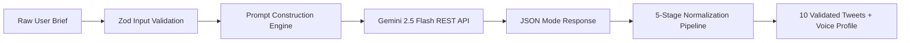
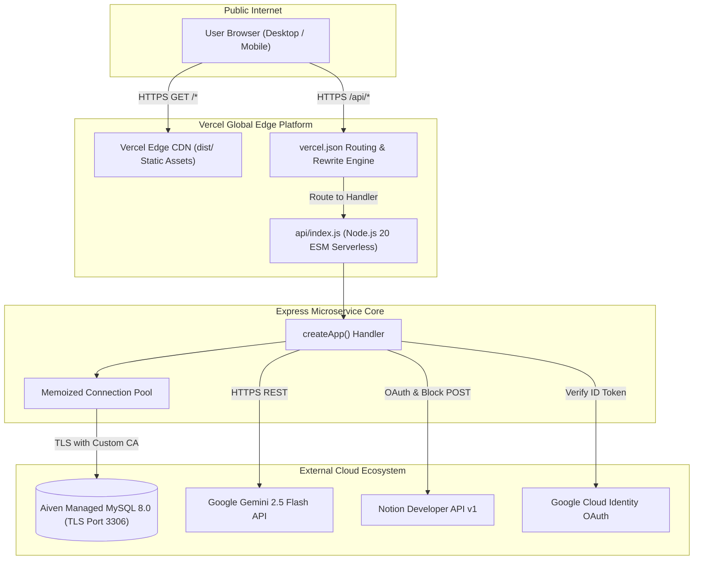

# Brand Voice AI — Technology Stack & Infrastructure Specification

---

## 1. Document Information

| Attribute | Details |
| :--- | :--- |
| **Document Title** | Technology Stack & Infrastructure Architecture Specification |
| **Product Name** | Brand Voice AI |
| **Document Version** | `1.0.0` |
| **Creation Date** | October 19, 2026 |
| **Document Status** | Approved Technical Specification |
| **Target Audience** | Senior Software Engineers, Technical Evaluators, Cloud Architects, and Engineering Hiring Managers |
| **Repository Path** | `C:\Users\surab\brand-voice-wizard-34` |
| **Git Remote** | `https://github.com/surabhi-04/brand-voice-wizard-34.git` (`main` branch) |

---

## 2. Technology Stack Overview

**Brand Voice AI** is engineered as a modern, decoupled cloud application composed of:
1. A static **React 19 Single-Page Application (SPA)** built with **Vite** and styled with **Tailwind CSS**, optimized for distribution across global edge CDNs.
2. A lightweight **Node.js + Express microservice** deployed as a **Vercel Serverless Function** (`api/index.js`), completely insulating third-party credentials and database secrets from the client.
3. An **Aiven Managed MySQL 8.0** relational database providing persistent multi-tenant storage with TLS encryption and automatic schema migrations.
4. Foundation AI synthesis powered by **Google Gemini 2.5 Flash** with deterministic JSON output validation and normalization.
5. Per-user workspace synchronization utilizing official **Notion Public OAuth 2.0** with **AES-256-GCM** encryption at rest.

### High-Level Architectural Tier Summary

| Layer | Technology | Purpose | Verification Status |
| :--- | :--- | :--- | :---: |
| **Frontend Framework** | React `19.2.0` | Component-based interactive editorial studio and reactive state tree | **Verified** |
| **Frontend Language** | TypeScript `5.8.3` | Static type safety, strict interface contracts, and schema mapping | **Verified** |
| **Build & Dev Tooling** | Vite `8.1.5` | High-speed local HMR development and production Rollup bundling | **Verified** |
| **Styling Framework** | Tailwind CSS `4.2.1` | Utility-first responsive design, modern CSS variables, and dark mode | **Verified** |
| **UI Component Primitives** | Radix UI Primitives | Accessible headless UI components (dialogs, tooltips, dropdowns) | **Verified** |
| **Icons & Notifications** | Lucide React + Sonner | Visual iconography and responsive toast alerts | **Verified** |
| **Backend Runtime** | Node.js (ESM modules) | Server-side execution environment for API services and test runners | **Verified** |
| **Backend Framework** | Express `4.21.2` | REST API routing, rate limiting, and cookie management | **Verified** |
| **Serverless Adapter** | Vercel Function Adapter (`api/index.js`) | Translates Vercel serverless HTTP invocations into Express handlers | **Verified** |
| **Schema Validation** | Zod `3.24.2` / `3.25.76` | Runtime input validation, schema coercion, and API contract guards | **Verified** |
| **Authentication** | Google Identity Services + JWT | Client GIS sign-in, server token verification, and 24h HttpOnly cookie | **Verified** |
| **Generative AI** | Google Gemini `2.5-flash` | Brand voice profile synthesis, 10 tweet drafting, and single regeneration | **Verified** |
| **External Workspace Sync** | Notion Public OAuth 2.0 & REST API | Per-user workspace authorization and direct block page creation | **Verified** |
| **Data Encryption** | AES-256-GCM (`node:crypto`) | Cryptographic authenticated encryption for Notion access tokens at rest | **Verified** |
| **Relational Database** | MySQL 8.0 (Aiven Cloud) | Multi-tenant persistence for users, campaigns, and OAuth connections | **Verified** |
| **Database Driver** | `mysql2` `3.24.6` | Connection pooling, prepared statements, and TLS CA verification | **Verified** |
| **Testing Frameworks** | `node:test` (Native) + Vitest `4.1.10` | 117 automated unit, integration, and security tests (63 server + 54 client) | **Verified** |
| **Cloud Hosting** | Vercel Edge Platform | Static asset hosting, serverless function compute, and edge rewrites | **Verified** |

---

## 3. Frontend Stack

```
┌──────────────────────────────────────────────────────────┐
│                   React 19.2.0 + TypeScript              │
├────────────────────────────┬─────────────────────────────┤
│  Styling & UI Components   │  State & Business Logic     │
│  - Tailwind CSS 4.2.1      │  - React useState / useMemo │
│  - Radix UI Primitives     │  - Custom useTheme Hook     │
│  - Lucide React Icons      │  - AuthContext Provider     │
│  - Sonner Toast Alerts     │  - SessionStorage Drafts    │
├────────────────────────────┴─────────────────────────────┤
│           Vite 8.1.5 Bundler & Dev Proxy (Port 8080)     │
└──────────────────────────────────────────────────────────┘
```

### 3.1 Framework & Core Engine
- **React (`^19.2.0`)**: Employs React 19's concurrent rendering architecture, modern functional component paradigms, and fine-grained hooks (`useState`, `useCallback`, `useMemo`, `useEffect`, `useContext`).
  - *Evidence*: [`package.json:L54`](file:///C:/Users/surab/brand-voice-wizard-34/package.json#L54), [`src/components/studio/BrandVoiceStudio.tsx`](file:///C:/Users/surab/brand-voice-wizard-34/src/components/studio/BrandVoiceStudio.tsx)
- **TypeScript (`^5.8.3`)**: Configured with strict type checking (`"strict": true`, `"exactOptionalPropertyTypes": true`), ESNext module resolution, and path alias mapping (`@/*` pointing to `src/*`).
  - *Evidence*: [`tsconfig.json`](file:///C:/Users/surab/brand-voice-wizard-34/tsconfig.json), [`src/lib/campaign-service.ts`](file:///C:/Users/surab/brand-voice-wizard-34/src/lib/campaign-service.ts)

### 3.2 Build Tooling & Bundling
- **Vite (`8.1.5`)**: Serves as the high-performance build tool and local development environment:
  - Local dev server configured on `0.0.0.0:8080` with strict port enforcement.
  - Native reverse proxy routing `/api` requests to the Express backend (`http://localhost:3001`), eliminating cross-origin complications during local pairing.
  - Production Rollup bundler generating minified, tree-shaken static assets in `dist/`.
  - *Evidence*: [`vite.config.ts`](file:///C:/Users/surab/brand-voice-wizard-34/vite.config.ts), [`package.json:L84`](file:///C:/Users/surab/brand-voice-wizard-34/package.json#L84)

### 3.3 Styling & UI Component Architecture
- **Tailwind CSS (`^4.2.1`)**: Integrated via `@tailwindcss/vite` compiler plugin. Replaces traditional utility-bloat with modern CSS custom properties and color variables tailored for editorial aesthetics.
  - *Evidence*: [`src/styles.css`](file:///C:/Users/surab/brand-voice-wizard-34/src/styles.css), [`vite.config.ts:L1`](file:///C:/Users/surab/brand-voice-wizard-34/vite.config.ts#L1)
- **Radix UI Headless Primitives**: Supplies accessible, keyboard-navigable UI primitives:
  - Dialogs and Modals (`@radix-ui/react-dialog`)
  - Dropdown Menus (`@radix-ui/react-dropdown-menu`)
  - Sliders, Switches, Tooltips, Separators, and Tabs
  - *Evidence*: [`package.json:L20-L45`](file:///C:/Users/surab/brand-voice-wizard-34/package.json#L20-L45), [`src/components/ui/`](file:///C:/Users/surab/brand-voice-wizard-34/src/components/ui/)
- **Lucide React (`^0.575.0`)**: Lightweight SVG iconography across form controls, tone pills, character indicators, copy actions, and modal windows.
  - *Evidence*: [`src/components/studio/BrandVoiceStudio.tsx:L2-L17`](file:///C:/Users/surab/brand-voice-wizard-34/src/components/studio/BrandVoiceStudio.tsx#L2-L17)
- **Sonner (`^2.0.7`)**: Toast notification system providing immediate tactile confirmation for clipboard copies, save completions, and network warnings.
  - *Evidence*: [`src/components/studio/BrandVoiceStudio.tsx:L18`](file:///C:/Users/surab/brand-voice-wizard-34/src/components/studio/BrandVoiceStudio.tsx#L18)

### 3.4 State Management & Routing
- **Single-Page Application (SPA) State**: Zero client-side routing runtime (such as React Router or TanStack Router) is needed. Navigation between the Studio, Saved Campaigns, and modals is managed reactively via local React component state and location hash (`#studio`).
- **Context API (`AuthContext`)**: Provides centralized session discovery, current user profiles, and sign-out capabilities across the component hierarchy.
  - *Evidence*: [`src/lib/auth-context.tsx`](file:///C:/Users/surab/brand-voice-wizard-34/src/lib/auth-context.tsx)
- **SessionStorage Draft Persistence**: Implements `brand_voice_active_campaign` key in browser `sessionStorage` to preserve active guest campaign inputs and outputs across OAuth redirects.
  - *Evidence*: [`BrandVoiceStudio.tsx:L84`](file:///C:/Users/surab/brand-voice-wizard-34/src/components/studio/BrandVoiceStudio.tsx#L84)

### 3.5 Client-Side API Communication & Dynamic Relative URLs
Frontend services encapsulate HTTP communication via standard browser `fetch`:
- **`campaign-service.ts`**: Handles `/api/campaigns/generate`, single/batch regeneration, guest draft transfers, and Notion exports.
- **`auth-service.ts`**: Handles `/api/auth/google`, `/api/auth/me`, `/api/auth/logout`, and `/api/auth/config`.
- **`notion-service.ts`**: Handles `/api/notion/status`, `/api/notion/destinations`, `/api/notion/destination`, and `/api/notion/disconnect`.
- **Dynamic Relative URL Architecture**: In production, `apiUrl(path)` resolves to a same-origin relative string (`"" + path`), routing seamlessly through Vercel's edge network without hardcoded hostnames or CORS overhead.
  - *Evidence*: [`src/lib/campaign-service.ts:L102-L106`](file:///C:/Users/surab/brand-voice-wizard-34/src/lib/campaign-service.ts#L102-L106)

---

## 4. Backend Stack

```
┌──────────────────────────────────────────────────────────┐
│             Vercel Serverless Function (api/index.js)    │
│             - Warm Instance Memoization (initPromise)    │
├──────────────────────────────────────────────────────────┤
│             Express 4.21.2 Application (createApp)       │
├────────────────────────────┬─────────────────────────────┤
│  Middleware Pipeline       │  Business Controllers       │
│  - CORS (Credentials)      │  - /api/auth/*              │
│  - CookieParser            │  - /api/campaigns/*         │
│  - ExpressRateLimit        │  - /api/notion/*            │
│  - Auth & OptionalAuth     │  - /api/health              │
├────────────────────────────┴─────────────────────────────┤
│            Services: Gemini 2.5 Flash | Notion REST API  │
│            Security: AES-256-GCM | Google Token Verifier │
│            Storage:  MySQL 8.0 Connection Pool (mysql2)  │
└──────────────────────────────────────────────────────────┘
```

### 4.1 Node.js Runtime & Express Architecture
- **Runtime**: Node.js executed natively using standard ES Modules (`"type": "module"`).
- **Express (`^4.21.2`)**: Structured around an application factory function (`createApp(options = {})`), allowing unit test suites to inject mock repositories, test credentials, or simulated network responses without spinning up separate ports.
  - *Evidence*: [`server/src/app.js:L222`](file:///C:/Users/surab/brand-voice-wizard-34/server/src/app.js#L222)
- **Vercel Serverless Function Adapter (`api/index.js`)**: Encapsulates the Express application into a cloud serverless function. Memoizes both `appInstance` and the database pool initialization (`initPromise`) to ensure warm function executions do not repeat MySQL connection handshakes.
  - *Evidence*: [`api/index.js`](file:///C:/Users/surab/brand-voice-wizard-34/api/index.js)

### 4.2 Middleware Infrastructure
1. **`cors` (`^2.8.5`)**: Configured with dynamic origin resolution supporting `http://localhost:8080`, `http://127.0.0.1:8080`, and production Vercel domains with `credentials: true`.
2. **`cookie-parser` (`^1.4.7`)**: Parses incoming signed session cookies (`bv_session`) for user identity resolution.
3. **`express.json({ limit: "1mb" })`**: Protects backend compute from denial-of-service memory exhaustion.
4. **`express-rate-limit` (`^8.7.1`)**:
   - Authentication Limiter: Enforces a ceiling of 50 requests per 15-minute window on `/api/auth/*`.
   - Guest Generation Limiter: Enforces a ceiling of 10 campaign generations per 15-minute window for unauthenticated IPs, preventing Gemini quota depletion while allowing authenticated users to bypass limits.
   - *Evidence*: [`server/src/app.js:L268-L307`](file:///C:/Users/surab/brand-voice-wizard-34/server/src/app.js#L268-L307)

### 4.3 Request Validation & Error Taxonomy
- **Zod (`^3.24.2`)**: Enforces strict input validation on all mutating endpoints (`campaignInputSchema`, `saveCampaignRequestSchema`, `tweetSchema`). Invalid payloads trigger 400 Bad Request with field-specific issue lists.
  - *Evidence*: [`server/src/schemas.js`](file:///C:/Users/surab/brand-voice-wizard-34/server/src/schemas.js)
- **Typed Error Hierarchy**:
  - `AuthError` (401 / 403 / 503) &rarr; Session and token verification issues.
  - `ConfigurationError` (503) &rarr; Missing Gemini, Google, or Notion server credentials.
  - `GeminiProviderError` (502 / 504) &rarr; Foundation AI provider timeouts or network faults.
  - `NotionApiError`, `NotionAuthError`, `NotionDestinationError` &rarr; Upstream Notion API exceptions.
  - *Evidence*: [`server/src/auth.js:L9-L16`](file:///C:/Users/surab/brand-voice-wizard-34/server/src/auth.js#L9-L16), [`server/src/gemini.js:L4-L18`](file:///C:/Users/surab/brand-voice-wizard-34/server/src/gemini.js#L4-L18), [`server/src/notion.js:L1-L22`](file:///C:/Users/surab/brand-voice-wizard-34/server/src/notion.js#L1-L22)

---

## 5. Programming Languages and Runtime

| Segment | Language / Standard | Target / Syntax | Project Files |
| :--- | :--- | :--- | :--- |
| **Frontend UI** | TypeScript `5.8.3` | ECMAScript 2022, React JSX (`react-jsx`) | `src/**/*.ts`, `src/**/*.tsx` |
| **Frontend Styling** | CSS3 / Tailwind CSS 4 | Custom Properties, Utility Classes | `src/styles.css` |
| **Backend Services** | JavaScript (ESM) | Node.js native ES modules (`import`/`export`) | `server/src/**/*.js` |
| **Serverless Adapter** | JavaScript (ESM) | Vercel Function specification (`export default async function`) | `api/index.js` |
| **Database Schema** | SQL (MySQL 8.0 Dialect) | DDL / DML (`CREATE TABLE IF NOT EXISTS`, `ON DUPLICATE KEY`) | `server/src/schema.sql` |
| **Configuration Files** | TypeScript, JSON | ESNext, standard JSON schemas | `vite.config.ts`, `vercel.json`, `tsconfig.json` |
| **Frontend Tests** | TypeScript | Vitest test runner syntax | `src/test/**/*.{ts,tsx}` |
| **Backend Tests** | JavaScript (ESM) | Node.js native runner syntax (`node:test`) | `server/test/**/*.js` |

### Runtime & Tooling Requirements
- **Node.js**: Minimum `18.0.0` or higher; verified compatible with Node `20.x` and Node `22.x`.
- **Package Manager**: `npm` version `9.0.0` or higher, utilizing native `workspaces: ["server"]` for monorepo-style unified dependency installations.

---

## 6. AI and Generative AI Stack



### 6.1 Model & API Configuration
- **Model Identifier**: `gemini-2.5-flash` (Google DeepMind)
- **API Protocol**: HTTPS REST API (`POST https://generativelanguage.googleapis.com/v1beta/models/gemini-2.5-flash:generateContent`)
- **Response Format**: Hardcoded `responseMimeType: "application/json"`
- **Sampling Temperature**: `0.7`
- **Request Timeout**: 30-second abort threshold via `AbortController`
- *Evidence*: [`server/src/gemini.js:L157-L200`](file:///C:/Users/surab/brand-voice-wizard-34/server/src/gemini.js#L157-L200)

### 6.2 Prompt Construction & Editorial Strategy
The prompt engine merges system rules with the structured brief:
- **System Prompt**: Defines Brand Voice AI as a senior editorial brand strategist and copywriter, enforcing pure JSON output without markdown fences.
- **Brand Profile Schema**: Requires `summary`, `audience`, `themes` (3-5 items), `characteristics` (3-5 items), and `inferredFields`.
- **Tweet Batch Constraints**: Demands exactly 10 tweets with `id`, `angle`, `tone`, `label`, and `text` under 280 characters.
- **Tone Whitelisting**: Strictly injects the user's selected tones (`["Bold", "Friendly"]`), instructing the model never to label tweets with unselected tones.
- *Evidence*: [`server/src/gemini.js:L83-L152`](file:///C:/Users/surab/brand-voice-wizard-34/server/src/gemini.js#L83-L152)

### 6.3 5-Stage Deterministic Post-Processing Pipeline
Because foundation models can occasionally drift, backend post-processing normalizes all responses:
1. **Batch Length Verification**: Confirms array contains exactly 10 items.
2. **Strict Tone Enforcement**: If an unselected tone is returned, it is algorithmically mapped to one of the user's selected preferred tones (`userTones[index % userTones.length]`).
3. **Angle Disambiguation**: Ensures communicative form labels ("Promotional", "Storytelling", "Educational", etc.) never collide with unselected tone names.
4. **Length Bounding**: Enforces character length (<280 chars) to prevent platform rejection.
5. **Emoji Target Reconciliation**: Counts actual emojis using Unicode regex (`\p{Extended_Pictographic}`); strips excess emojis if over target, or tastefully appends editorial emojis if under target.
- *Evidence*: [`server/src/gemini.js:L238-L345`](file:///C:/Users/surab/brand-voice-wizard-34/server/src/gemini.js#L238-L345)

---

## 7. Database and Data Persistence

### 7.1 Architecture & Managed Engine
- **Engine**: MySQL 8.0 / 8.4 engine hosted on **Aiven Managed Cloud**.
- **Driver**: `mysql2` (`^3.24.6`) with `promise`-based async/await support.
- **Connection Pooling**: Managed via `createDatabasePool(dbConfig)`. Automatically detects Vercel serverless environments and caps connections:
  - Local / Standalone: `10` connections.
  - Vercel Serverless: `3` connections per function instance.
  - *Evidence*: [`server/src/db.js:L575-L585`](file:///C:/Users/surab/brand-voice-wizard-34/server/src/db.js#L575-L585)

### 7.2 Strict TLS/SSL & Aiven Certificate Validation
- **TLS Configuration**: When `MYSQL_SSL=true`, the pool enforces strict verification:
  ```javascript
  const sslOptions = { rejectUnauthorized: true };
  if (dbConfig.caCert) {
    sslOptions.ca = dbConfig.caCert;
  }
  poolOptions.ssl = sslOptions;
  ```
- **Aiven CA Support**: Accepts `MYSQL_CA_CERT` containing Aiven's Project CA certificate PEM string, enabling end-to-end TLS encryption with complete cryptographic server verification over the public internet.
- *Evidence*: [`server/src/db.js:L563-L572`](file:///C:/Users/surab/brand-voice-wizard-34/server/src/db.js#L563-L572)

### 7.3 Schema & Relational Tables
Auto-migrated via [`server/src/schema.sql`](file:///C:/Users/surab/brand-voice-wizard-34/server/src/schema.sql):
1. **`users`**: Stores authenticated identities (`id`, `google_id`, `name`, `email`, `profile_picture`, timestamps).
2. **`campaigns`**: Stores campaign data (`id`, `user_id`, `brand_name`, `industry`, `campaign_objective`, `product_info`, JSON `brand_voice_profile`, JSON `tweets`, `notion_url`, `notion_page_id`, timestamps). Foreign key references `users(id)` with cascading deletion.
3. **`user_notion_connections`**: Stores per-user OAuth tokens (`id`, `user_id UNIQUE`, `workspace_id`, `workspace_name`, `encrypted_access_token`, `destination_page_id`, `destination_page_name`, `status`, timestamps).

### 7.4 In-Memory Repository Fallback (`MemoryRepository`)
If MySQL is unconfigured (`MYSQL_USER` is empty) or temporarily unreachable, `api/index.js` and `app.js` automatically activate [`MemoryRepository`](file:///C:/Users/surab/brand-voice-wizard-34/server/src/db.js#L8-L229). It uses native `Map` collections to implement the exact same repository interface, guaranteeing that test suites and offline demos never crash.

---

## 8. Authentication and Security Technologies

```
┌──────────────────────────────────────────────────────────┐
│                   Security Controls                      │
├────────────────────────────┬─────────────────────────────┤
│  Authentication            │  Cryptographic Protection   │
│  - Google Identity (GIS)   │  - AES-256-GCM (Notion)     │
│  - Server ID Verification  │  - HMAC-SHA256 (JWT)        │
│  - HttpOnly Session Cookie │  - CSRF Signed State Tokens │
├────────────────────────────┼─────────────────────────────┤
│  Network & Perimeter       │  Access & Multi-Tenancy     │
│  - express-rate-limit      │  - Row-Level User Scoping   │
│  - Credentialed CORS       │  - Zero Client-Side Keys    │
│  - TLS (Aiven MySQL)       │  - Ephemeral Guest Storage  │
└────────────────────────────┴─────────────────────────────┘
```

1. **Google Identity Services (GIS)**:
   - Client initializes official Google button using Client ID fetched from `/api/auth/config`.
   - Backend verifies ID token signature, expiration, and audience using `google-auth-library` (`OAuth2Client.verifyIdToken`).
   - *Evidence*: [`server/src/auth.js:L22-L62`](file:///C:/Users/surab/brand-voice-wizard-34/server/src/auth.js#L22-L62)
2. **JWT Session Management (`jsonwebtoken`)**:
   - Backend issues session JWT with claims (`sub`, `iss: "brand-voice-ai"`, `aud: "brand-voice-ai-app"`, `exp: "24h"`).
   - Stored in an `HttpOnly`, `SameSite: Lax`, `Secure` (production) cookie named `bv_session`.
   - *Evidence*: [`server/src/auth.js:L106-L169`](file:///C:/Users/surab/brand-voice-wizard-34/server/src/auth.js#L106-L169)
3. **AES-256-GCM Token Encryption (`node:crypto`)**:
   - Access tokens received from Notion are encrypted at rest with a 256-bit key (`NOTION_TOKEN_ENCRYPTION_KEY`).
   - Output format: `<iv_hex>:<auth_tag_hex>:<ciphertext_hex>`.
   - Tampered tokens or modified tags immediately throw cryptographic decipher errors.
   - *Evidence*: [`server/src/crypto.js:L27-L68`](file:///C:/Users/surab/brand-voice-wizard-34/server/src/crypto.js#L27-L68)
4. **Account-Linking CSRF Protection**:
   - Notion OAuth URL binds the initiating user ID to a 15-minute signed JWT state token.
   - Callback verifies signature and verifies that `state.userId === req.user.id`.
   - *Evidence*: [`server/src/crypto.js:L74-L97`](file:///C:/Users/surab/brand-voice-wizard-34/server/src/crypto.js#L74-L97), [`server/src/app.js:L520-L545`](file:///C:/Users/surab/brand-voice-wizard-34/server/src/app.js#L520-L545)
5. **Multi-Tenant Row-Level Scoping**:
   - All database updates and queries enforce `WHERE user_id = req.user.id`.
   - Unauthenticated guest generations are strictly written to client-side `sessionStorage`, guaranteeing no cross-contamination into private database accounts.

---

## 9. Third-Party APIs and Integrations

| Service | Purpose | Integration Method | Relevant Implementation Files | Status |
| :--- | :--- | :--- | :--- | :---: |
| **Google Identity Services** | User authentication & email identification | Client GIS Button + Backend `google-auth-library` verification | [`src/components/auth/GoogleSignInButton.tsx`](file:///C:/Users/surab/brand-voice-wizard-34/src/components/auth/GoogleSignInButton.tsx)<br>[`server/src/auth.js`](file:///C:/Users/surab/brand-voice-wizard-34/server/src/auth.js) | **Active (Core)** |
| **Google Gemini API** | AI voice analysis & 10-tweet batch drafting | HTTPS REST API (`/v1beta/models/gemini-2.5-flash:generateContent`) | [`server/src/gemini.js`](file:///C:/Users/surab/brand-voice-wizard-34/server/src/gemini.js) | **Active (Core)** |
| **Notion OAuth 2.0** | Per-user external workspace authorization | Public OAuth 2.0 Authorization Code flow with CSRF state | [`server/src/notion.js`](file:///C:/Users/surab/brand-voice-wizard-34/server/src/notion.js)<br>[`server/src/app.js`](file:///C:/Users/surab/brand-voice-wizard-34/server/src/app.js#L468-L613) | **Active (Core)** |
| **Notion REST API v1** | Search accessible parent pages and export campaign blocks | Official Notion REST API (`POST /v1/pages`, `POST /v1/search`) | [`server/src/notion.js`](file:///C:/Users/surab/brand-voice-wizard-34/server/src/notion.js#L140-L320) | **Active (Core)** |
| **Aiven MySQL** | Managed cloud relational database | TLS MySQL wire protocol over port 3306 via `mysql2` | [`server/src/db.js`](file:///C:/Users/surab/brand-voice-wizard-34/server/src/db.js) | **Active (Core)** |
| **Vercel** | Edge CDN hosting & Serverless Function execution | Static asset deployment + `api/index.js` rewrite adapter | [`vercel.json`](file:///C:/Users/surab/brand-voice-wizard-34/vercel.json)<br>[`api/index.js`](file:///C:/Users/surab/brand-voice-wizard-34/api/index.js) | **Active (Core)** |
| **n8n Automation Engine** | Webhook-based Notion export (Single-workspace prototype) | HTTP POST Webhook (`N8N_NOTION_WEBHOOK_URL`) | [`server/src/app.js:L1103-L1250`](file:///C:/Users/surab/brand-voice-wizard-34/server/src/app.js#L1103-L1250) | **Legacy / Fallback** |

---

## 10. Deployment and Infrastructure



### Deployment Configuration Highlights
- **Vercel Build Command**: `npm run build`
- **Vercel Output Directory**: `dist`
- **Function Execution Timeout**: Configured via `vercel.json`:
  ```json
  "functions": {
    "api/index.js": { "maxDuration": 60 }
  }
  ```
  Permits up to 60 seconds for generative AI processing.
- **Rewrites Table**:
  1. `/api/(.*)` &rarr; `/api/index.js` (routes all backend microservices).
  2. `/(.*)` &rarr; `/index.html` (routes all non-API paths to the Vite SPA entry point).
- *Evidence*: [`vercel.json`](file:///C:/Users/surab/brand-voice-wizard-34/vercel.json)

---

## 11. Testing Stack

The project maintains **117 automated tests** across 17 test suites, providing robust coverage for business logic, security controls, and edge cases:

### 11.1 Backend Test Infrastructure
- **Test Runner**: Node.js Native Test Runner (`node:test`)
- **Assertion Library**: `node:assert/strict`
- **Execution Script**: `npm test --prefix server` (`node --test test/*.test.js test/**/*.test.js`)
- **Verified Results**: **63 passing tests across 12 suites (0 failures)**:
  1. `server/test/auth.test.js` (12 tests) &rarr; Google token verification, JWT issuance, HttpOnly cookies, auth middleware, and rate limits.
  2. `server/test/gemini.test.js` (14 tests) &rarr; Prompt generation, tone whitelisting, emoji reconciliation, and single/batch regeneration.
  3. `server/test/multi-user-isolation.test.js` (7 tests) &rarr; Two-user data isolation, cross-tenant protection, and guest demo safety.
  4. `server/test/mysql.test.js` (10 tests) &rarr; MySQL migrations, CRUD lifecycle, health check endpoint, and Aiven SSL/TLS certificate handling.
  5. `server/test/notion.test.js` (20 tests) &rarr; AES-256-GCM encryption, CSRF state signing, token exchange, destination selection, and page block creation.

### 11.2 Frontend Test Infrastructure
- **Test Runner**: Vitest (`4.1.10`)
- **Component Testing**: `@testing-library/react` (`^16.0.0`), `@testing-library/jest-dom` (`^6.6.0`)
- **DOM Environment**: `jsdom` (`^20.0.3`)
- **Execution Script**: `npm test -- --run`
- **Verified Results**: **54 passing tests across 5 test files (0 failures)**:
  1. `src/test/campaign-service.test.ts` (16 tests) &rarr; Zod schema parsing, character counters, and API error extraction.
  2. `src/test/theme.test.tsx` (6 tests) &rarr; Dark/light theme toggling and localStorage persistence.
  3. `src/test/auth-flow.test.tsx` (6 tests) &rarr; Google sign-in button, user profile menu, and login-required modals.
  4. `src/test/notion-integration.test.tsx` (9 tests) &rarr; Notion connect modals, destination selector, and status indicator.
  5. `src/test/brand-voice-studio.test.tsx` (17 tests) &rarr; Full editorial studio flow, form resets, in-place regeneration, and Notion save feedback.

---

## 12. Development Tools

| Tool | Version / Command | Purpose in Project |
| :--- | :--- | :--- |
| **Git** | `2.x` | Source code version control tracking conventional commits |
| **GitHub** | Remote `origin` | Central repository hosting and CI/CD triggers |
| **npm** | `9.x`+ | Dependency package manager managing root and `server` workspaces |
| **Vite Dev Server** | `npm run dev` | Local frontend dev server on `http://localhost:8080` with API proxy |
| **Express Dev Server** | `npm run dev:server` | Local backend dev server with Node `--watch` on `http://localhost:3001` |
| **ESLint** | `^9.32.0` (`npm run lint`) | Static analysis detecting syntax flaws and React hook violations |
| **Prettier** | `^3.7.3` (`npm run format`) | Automated code formatting enforcing uniform whitespace and syntax standards |
| **TypeScript Compiler** | `tsc --noEmit` | Type checking without emitting code (`noEmit: true`) |

---

## 13. Technology-to-Feature Mapping

| Feature / Capability | Implementing Technologies | Codebase Location |
| :--- | :--- | :--- |
| **Editorial Studio Form** | React 19, Tailwind CSS 4, Lucide Icons, Zod | [`src/components/studio/BrandVoiceStudio.tsx`](file:///C:/Users/surab/brand-voice-wizard-34/src/components/studio/BrandVoiceStudio.tsx) |
| **Brand Voice Synthesis** | Google Gemini 2.5 Flash, Zod, System Prompts | [`server/src/gemini.js`](file:///C:/Users/surab/brand-voice-wizard-34/server/src/gemini.js#L83-L152) |
| **10-Tweet Generation** | Gemini 2.5 Flash, 5-Stage Post-Processor | [`server/src/gemini.js`](file:///C:/Users/surab/brand-voice-wizard-34/server/src/gemini.js#L238-L345) |
| **Granular Regeneration** | Express routes, Gemini API, In-Place React State | [`server/src/app.js`](file:///C:/Users/surab/brand-voice-wizard-34/server/src/app.js#L757-L850) |
| **Guest Demo Mode** | Express rate limit, `sessionStorage`, Auth Guards | [`server/src/app.js:L295`](file:///C:/Users/surab/brand-voice-wizard-34/server/src/app.js#L295), [`BrandVoiceStudio.tsx`](file:///C:/Users/surab/brand-voice-wizard-34/src/components/studio/BrandVoiceStudio.tsx) |
| **Google Authentication** | GIS Client SDK, `google-auth-library`, JWT | [`server/src/auth.js`](file:///C:/Users/surab/brand-voice-wizard-34/server/src/auth.js), [`GoogleSignInButton.tsx`](file:///C:/Users/surab/brand-voice-wizard-34/src/components/auth/GoogleSignInButton.tsx) |
| **Session Persistence** | `bv_session` HttpOnly Cookie, `auth-context.tsx` | [`server/src/auth.js:L160`](file:///C:/Users/surab/brand-voice-wizard-34/server/src/auth.js#L160), [`auth-context.tsx`](file:///C:/Users/surab/brand-voice-wizard-34/src/lib/auth-context.tsx) |
| **Notion Public OAuth** | Notion OAuth API, CSRF State JWT, AES-256-GCM | [`server/src/notion.js`](file:///C:/Users/surab/brand-voice-wizard-34/server/src/notion.js), [`server/src/crypto.js`](file:///C:/Users/surab/brand-voice-wizard-34/server/src/crypto.js) |
| **Notion Block Export** | Notion REST API v1 (`POST /v1/pages`) | [`server/src/notion.js:L189-L320`](file:///C:/Users/surab/brand-voice-wizard-34/server/src/notion.js#L189-L320) |
| **Campaign Storage** | MySQL 8.0 (`brandvoice_db`), `mysql2/promise` | [`server/src/db.js`](file:///C:/Users/surab/brand-voice-wizard-34/server/src/db.js), [`server/src/schema.sql`](file:///C:/Users/surab/brand-voice-wizard-34/server/src/schema.sql) |
| **Multi-Tenant Isolation** | Row-level user scoping, 1-to-1 Notion foreign keys | [`server/src/app.js`](file:///C:/Users/surab/brand-voice-wizard-34/server/src/app.js), [`server/test/multi-user-isolation.test.js`](file:///C:/Users/surab/brand-voice-wizard-34/server/test/multi-user-isolation.test.js) |
| **Dark / Light Theming** | Tailwind CSS `.dark` class, `useTheme`, `localStorage` | [`src/hooks/use-theme.ts`](file:///C:/Users/surab/brand-voice-wizard-34/src/hooks/use-theme.ts), [`src/styles.css`](file:///C:/Users/surab/brand-voice-wizard-34/src/styles.css) |
| **Production Hosting** | Vercel Edge CDN + Serverless Function Adapter | [`vercel.json`](file:///C:/Users/surab/brand-voice-wizard-34/vercel.json), [`api/index.js`](file:///C:/Users/surab/brand-voice-wizard-34/api/index.js) |

---

## 14. Version and Dependency Inventory

### 14.1 Root Frontend Direct Dependencies (`package.json`)
| Package Name | Specified Version | Purpose in Application |
| :--- | :--- | :--- |
| `react` | `^19.2.0` | UI component rendering engine |
| `react-dom` | `^19.2.0` | React DOM bindings for web |
| `tailwindcss` | `^4.2.1` | Styling compiler engine |
| `@tailwindcss/vite` | `^4.2.1` | Vite integration for Tailwind v4 |
| `lucide-react` | `^0.575.0` | Visual iconography library |
| `sonner` | `^2.0.7` | Toast notification provider |
| `zod` | `^3.25.76` | Frontend schema parsing and type inference |
| `@radix-ui/react-dialog` | `^1.1.15` | Accessible modal dialog container |
| `@radix-ui/react-dropdown-menu` | `^2.1.16` | User profile menu dropdown |
| `@radix-ui/react-slot` | `^1.2.4` | Component polymorphism (`asChild`) |
| `@radix-ui/react-tooltip` | `^1.2.8` | Informational badge hover tooltips |
| `clsx` | `^2.1.1` | Conditional className concatenation |
| `tailwind-merge` | `^3.5.0` | Conflict-free Tailwind class resolution |

### 14.2 Root Frontend Developer Dependencies (`package.json`)
| Package Name | Specified Version | Purpose in Development |
| :--- | :--- | :--- |
| `vite` | `8.1.5` | Development server and production bundler |
| `typescript` | `^5.8.3` | TypeScript compiler and language server |
| `vitest` | `^4.1.10` | Automated frontend test runner |
| `@testing-library/react` | `^16.0.0` | React DOM test integration |
| `@testing-library/jest-dom` | `^6.6.0` | DOM matcher extensions for assertions |
| `jsdom` | `^20.0.3` | Headless browser DOM simulation |
| `eslint` | `^9.32.0` | Code quality linter |
| `prettier` | `^3.7.3` | Code formatter |

### 14.3 Backend Server Dependencies (`server/package.json`)
| Package Name | Specified Version | Purpose in Backend Microservice |
| :--- | :--- | :--- |
| `express` | `^4.21.2` | Core web framework and HTTP routing |
| `mysql2` | `^3.24.6` | MySQL promise-based client driver with connection pooling |
| `google-auth-library` | `^11.3.1` | Official Google server-side ID token verification |
| `jsonwebtoken` | `^9.0.3` | HMAC-SHA256 session token and CSRF state signing |
| `express-rate-limit` | `^8.7.1` | Brute force defense and guest IP rate limiting |
| `cookie-parser` | `^1.4.7` | HTTP request cookie deserialization |
| `cors` | `^2.8.5` | Credentialed Cross-Origin Resource Sharing handling |
| `zod` | `^3.24.2` | Backend request payload schema validation |
| `dotenv` | `^16.4.7` | Local development environment file loading |

---

## 15. Configuration Requirements

```
┌─────────────────────────────────────────────────────────────┐
│               Environment Configuration Model               │
├──────────────────────────────┬──────────────────────────────┤
│  Frontend Public Variables   │  Backend Secret Variables    │
│  (Injected into Bundle)      │  (Serverless Runtime Only)   │
│  - VITE_API_BASE_URL         │  - GEMINI_API_KEY            │
│  - VITE_GOOGLE_CLIENT_ID     │  - GOOGLE_CLIENT_ID          │
│                              │  - JWT_SECRET                │
│                              │  - MYSQL_PASSWORD            │
│                              │  - MYSQL_CA_CERT             │
│                              │  - NOTION_OAUTH_CLIENT_SECRET│
│                              │  - NOTION_TOKEN_ENCRYPTION_  │
│                              │    KEY                       │
└──────────────────────────────┴──────────────────────────────┘
```

### 15.1 Client-Accessible Variables (`.env`)
These variables are compiled into client assets by Vite. **They must never contain private credentials:**
- `VITE_API_BASE_URL`: In production on Vercel, left empty `""` (uses same-origin relative `/api/*`). In local dev: `http://localhost:3001`.
- `VITE_GOOGLE_CLIENT_ID`: Public Google OAuth Web Client ID for GIS button initialization.

### 15.2 Server-Only Secret Variables (`server/.env` / Vercel Project Settings)
Injected exclusively into backend execution memory:
- `GEMINI_API_KEY`: Google AI Studio API key (`AIzaSy...`).
- `GEMINI_MODEL`: Model name (default: `gemini-2.5-flash`).
- `GOOGLE_CLIENT_ID`: Google OAuth Web Client ID for server token verification.
- `JWT_SECRET`: 256-bit random string for signing user sessions.
- `MYSQL_HOST`: Cloud database host (`mysql-xxxx.aivencloud.com`).
- `MYSQL_PORT`: Cloud database custom port (`11342` or `3306`).
- `MYSQL_DATABASE`: Database schema name (`defaultdb` or `brandvoice_db`).
- `MYSQL_USER`: Database username (`avnadmin`).
- `MYSQL_PASSWORD`: Database user password.
- `MYSQL_SSL`: Set to `true` to enable TLS.
- `MYSQL_CA_CERT`: Aiven Project CA Certificate PEM text.
- `MYSQL_SKIP_CREATE_DB`: Set to `true` to skip root-level `CREATE DATABASE` queries.
- `NOTION_OAUTH_CLIENT_ID`: Notion Public Integration Client ID.
- `NOTION_OAUTH_CLIENT_SECRET`: Notion Public Integration Client Secret.
- `NOTION_OAUTH_REDIRECT_URI`: Authorized callback URL (`https://<domain>/api/notion/oauth/callback`).
- `NOTION_TOKEN_ENCRYPTION_KEY`: Dedicated 64-character hex key for AES-256-GCM token encryption.

---

## 16. Technical Constraints and Trade-offs

1. **Serverless Ephemerality & Connection Pooling**:
   - *Constraint*: Serverless functions can spawn multiple ephemeral instances under traffic surges.
   - *Design Trade-off*: Database connection pools are capped at 3 connections on Vercel (`process.env.VERCEL ? 3 : 10`). Connection pools and app instances are memoized in module scope (`appInstance` and `initPromise`) to reuse open sockets across warm invocations.
2. **Generative Model Latency**:
   - *Constraint*: Full 10-tweet generation with voice profile extraction requires 3 to 6 seconds of AI reasoning.
   - *Design Trade-off*: Vercel execution timeout is explicitly increased to 60 seconds (`maxDuration: 60`), and the client provides dynamic cycling status text ("Analyzing brand brief...", "Drafting 10 high-impact tweets...") to maintain engagement.
3. **Third-Party Rate Limits**:
   - *Constraint*: Google Gemini free/tier-1 quotas and Notion API rate limits (3 requests per second).
   - *Design Trade-off*: The backend implements IP rate limiting on guest generations (10 req/15 min) and caches Notion save statuses to prevent duplicate API dispatches.
4. **Decoupled Architecture with Single Vercel Project**:
   - *Constraint*: Running an Express backend and React SPA in a single repository without managing separate infrastructure.
   - *Design Trade-off*: Utilizes npm workspaces (`"workspaces": ["server"]`) and an `api/index.js` serverless function adapter with `vercel.json` rewrites, providing the simplicity of a monorepo with the security of a decoupled backend.

---

## 17. Future Technology Improvements

1. **Streaming Output Delivery**:
   - *Recommendation*: Transition from monolithic JSON HTTP responses to Server-Sent Events (SSE) or Fetch Streams, allowing tweet cards to stream into the UI progressively as the model generates them.
2. **Distributed Cache Layer (Redis / Upstash)**:
   - *Recommendation*: Implement an edge Redis cache for frequently queried brand voice profiles and user rate limits, reducing MySQL load and ensuring global rate-limiting consistency.
3. **Direct Social Publishing Adapters**:
   - *Recommendation*: Expand OAuth integration to X/Twitter API v2 and LinkedIn Marketing API for one-click publishing and scheduled delivery directly from the studio.
4. **Vector Database for Brand Voice Memory**:
   - *Recommendation*: Integrate a vector store (e.g. Pinecone or pgvector) to store and semantically retrieve historical high-performing tweets for continuous brand voice fine-tuning.

---

## 18. References & Documentation Links

### Project Architecture & Requirements
- [Product Requirements Document (PRD)](./PRD.md)
- [PRD Review & Verification Checklist](./PRD-REVIEW-CHECKLIST.md)
- [System Architecture Specification](./ARCHITECTURE.md)
- [API Contracts & Integration Guide](./api-contracts.md)

### Official Technology Documentation
- [React 19 Documentation](https://react.dev/)
- [Vite Next Generation Frontend Tooling](https://vitejs.dev/)
- [Tailwind CSS v4 Documentation](https://tailwindcss.com/)
- [Express.js Web Application Framework](https://expressjs.com/)
- [Google Gemini API Documentation](https://ai.google.dev/gemini-api/docs)
- [Google Identity Services (GIS)](https://developers.google.com/identity/gsi/web/guides/overview)
- [Notion Developers API Documentation](https://developers.notion.com/)
- [Aiven for MySQL Documentation](https://aiven.io/docs/products/mysql)
- [Vercel Serverless Functions Documentation](https://vercel.com/docs/functions)
